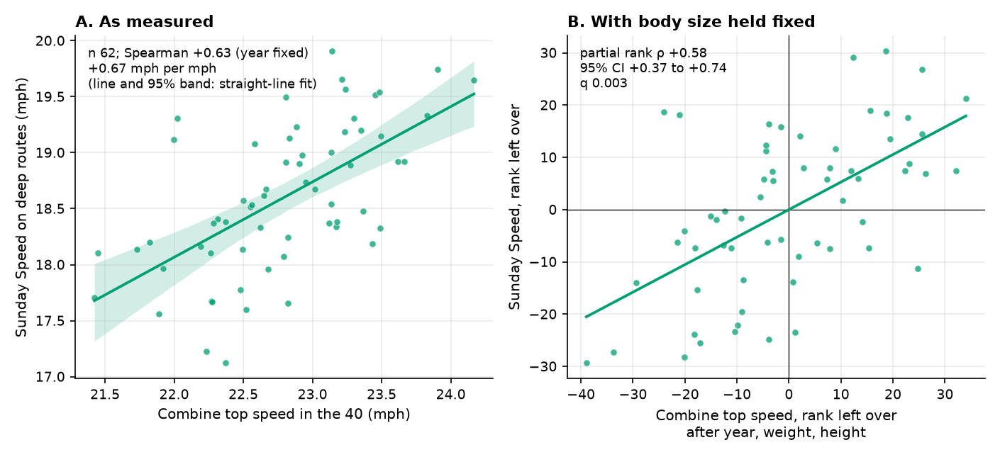
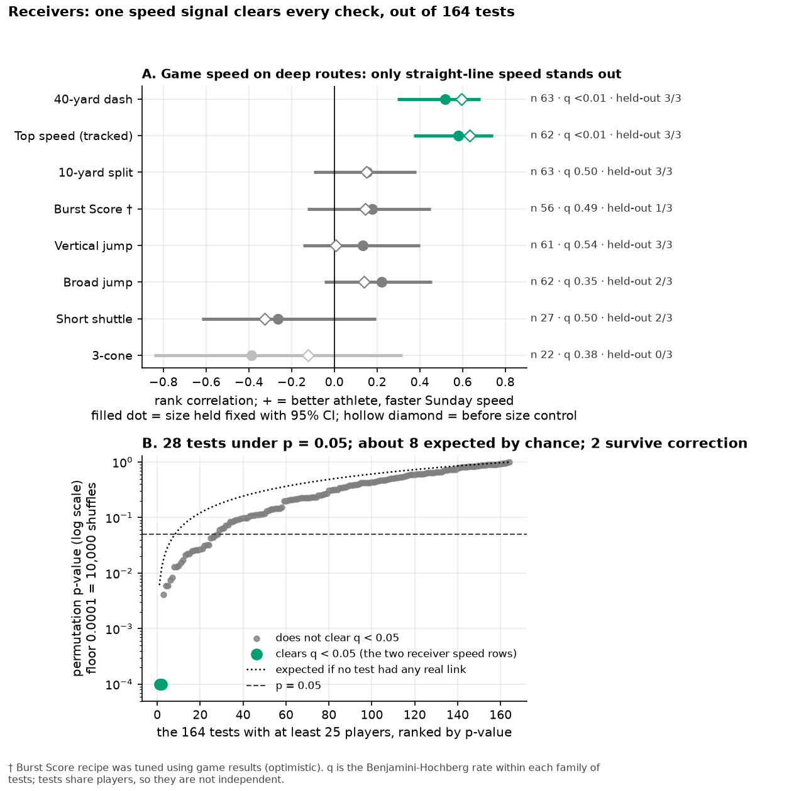
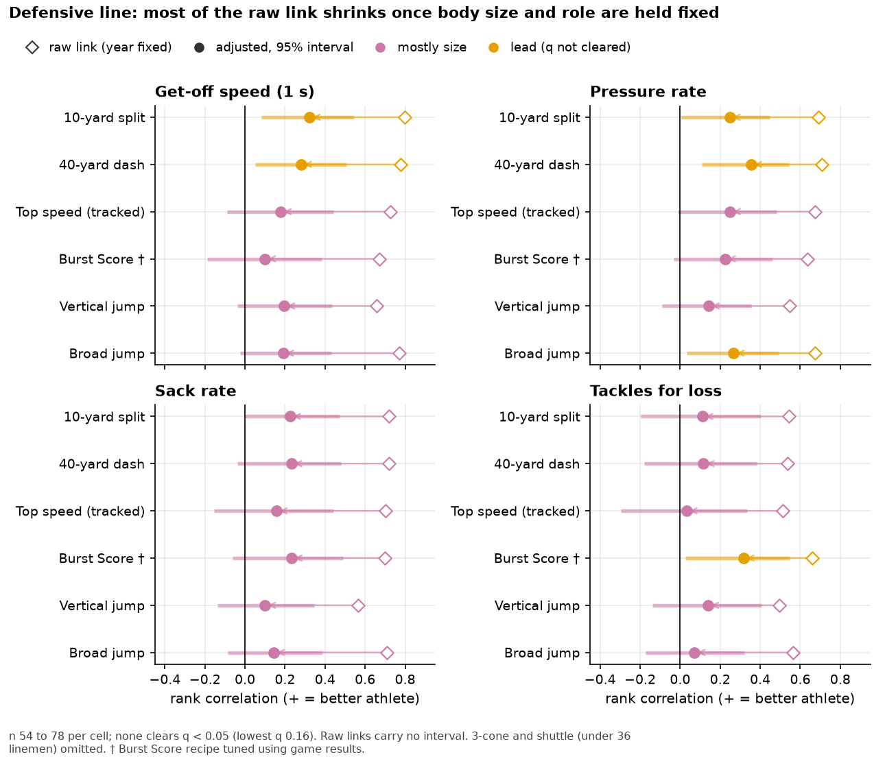
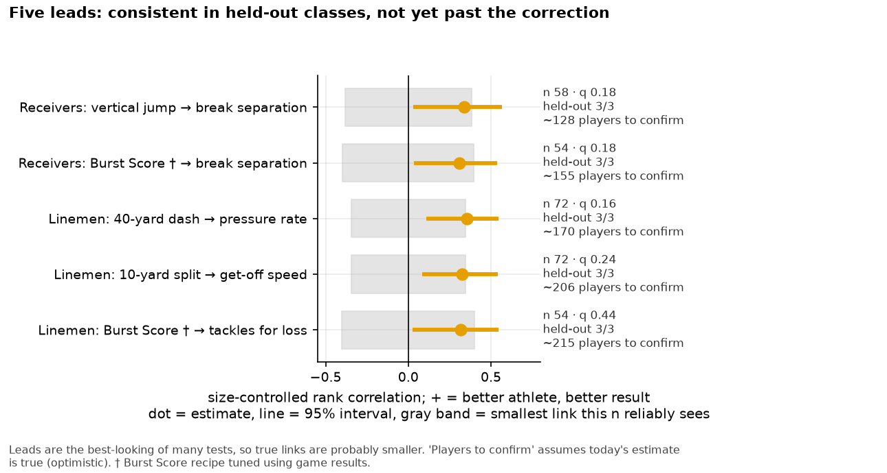
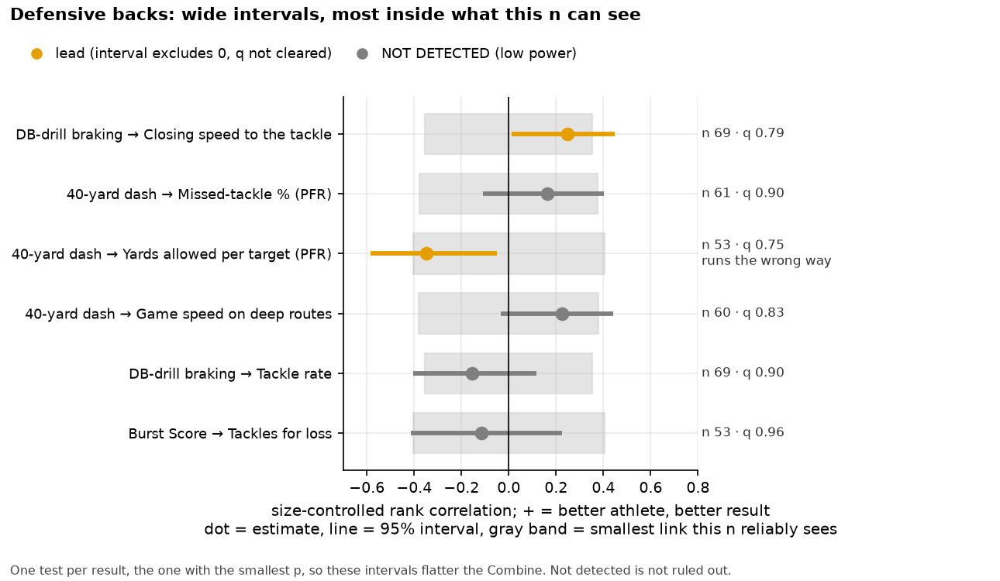
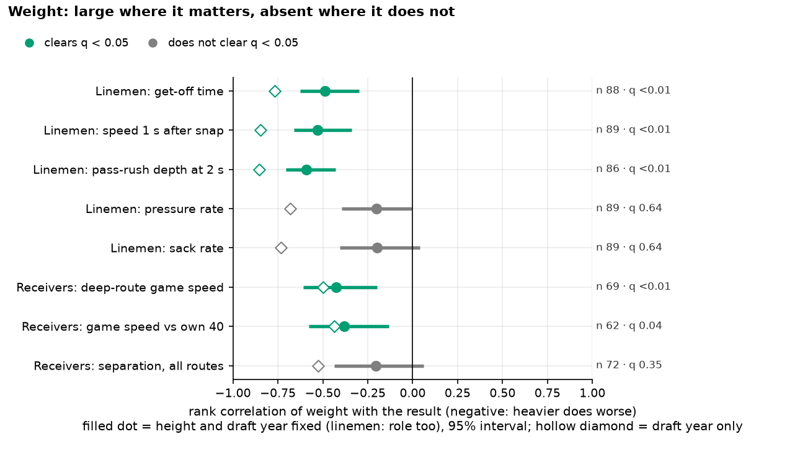
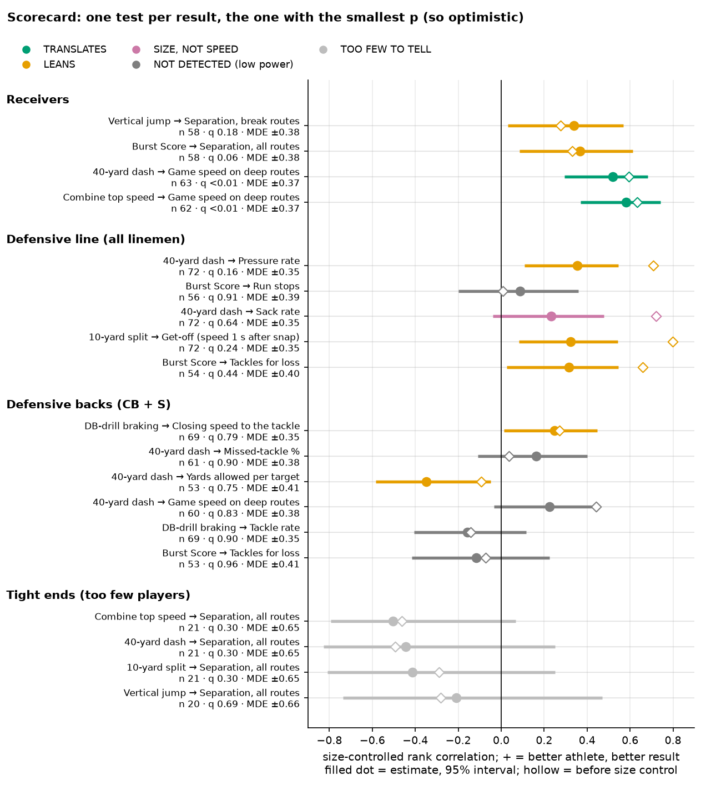

*NFL Big Data Bowl 2027 · Open Track · Combine tracking linked to regular-season game tracking · WR, TE, DB, DL*

**Three positions, three stories.** Receivers: speed is real and shows up on Sunday. Linemen: the drills predict pass rush, mostly through body size, so read them size-adjusted. Defensive backs: the Combine alone is a weak guide at this sample size.

**The required link, stated plainly.** We connect each rookie's 10 Hz Combine tracking (2023 to 2025 classes) to his regular-season game tracking. A receiver's tracked Combine top speed predicts his regular-season speed on deep routes (ρ +0.63 year-controlled, **+0.58 with body size held fixed**, n 62). The attached public notebook recomputes that from the raw tracking files.

Data: the competition's Combine, game-tracking, play, player and game files, plus public Pro-Football-Reference stats via nflverse (two DB outcomes). Source: NFL Big Data Bowl 2027 (CC BY-NC 4.0). No draft-position information is used; draft *year* is a control only. Running backs are excluded. **Sunday Speed** is a player's 90th-percentile top speed per play where his job asks for speed (deep routes for receivers; man or deep coverage for defensive backs), regular season. **Burst Score** is a 0 to 100 within-position blend of the tracked 20-yard time and the jumps. ρ is a rank correlation; positive means the better athlete does better.

*Figure 1. Each dot is a receiver. A: as measured. B: after removing draft year, weight and height from both axes (ranks).*

## 1. Receivers: speed is real, and it carries to Sunday
Two Combine measures clear every check, and both are receiver straight-line speed. The 40-yard dash goes with faster game speed on deep routes (ρ +0.52 with size held fixed, 95% CI +0.30 to +0.68, n 63, q <0.01). Tracked Combine top speed is stronger (+0.58, +0.37 to +0.74, n 62, q <0.01). Both improve predictions on held-out draft classes (3/3 each).

Each extra mph of Combine top speed goes with about 0.67 mph more on a deep route in a game (Figure 1). Size barely moves it, unlike the defensive line. The other receiver tests (10-yard split, jumps, shuttle, Burst Score) were not detected (about 0.37 or more was needed).

Figure 2 is the proof of method. Of 164 tests with at least 25 players, 28 reach p < 0.05 against about 8 expected by chance (cells share players, so that overstates independent findings). After false-discovery correction exactly 2 remain, both receiver rows. The method finds real signal where it exists. A blind unsupervised search that never saw game outcomes rediscovered this speed axis (ρ +0.50, q 0.004; held-out +0.44, 3 of 3 classes).

*Figure 2. A: every receiver test against deep-route speed. B: all 164 tests; only two survive correction.*

## 2. Defensive line: the drills predict pass rush, mostly through body size
Faster linemen get off quicker, rush more and sack more, but much of that is body size. Across 32 cells with at least 25 players (tests against get-off, pressure, sack and tackles for loss), the median year-controlled link is ρ +0.68. Hold weight, height and role (edge or interior) fixed and it is +0.21: about 69% of the raw link is shared with body size and role (a statistical split, not proof of cause; Figure 3).

What remains is still positive:
- The 40 against **pressure rate** goes from +0.71 to +0.35 (95% CI +0.11 to +0.54, q 0.16).
- The 10-yard split against **get-off speed** goes from +0.80 to +0.32 (q 0.24).
- The 40 against **sack rate** goes from +0.72 to +0.23, and its interval (-0.04 to +0.48) now touches zero.

The pressure lean appears separately for edge (+0.35, n 39) and interior (+0.40, n 33) rushers. Of 33 defensive-line cells with a raw link of at least 0.30, 32 lose half or more to size; none of 6 receiver or DB cells do.

*Figure 3. Defensive-line tests, raw to size-adjusted. The gap is what body size and role account for.*

## 3. Consistent leads that need more seasons
Five results hold in every held-out draft class (3/3 each) but do not clear the false-discovery bar. We call them leads:
- **Receivers:** a higher vertical jump (+0.34, n 58, q 0.18) and Burst Score (+0.31, n 54, q 0.18) go with more separation on break routes.
- **Defensive line:** the 40 goes with pressure rate (+0.35, q 0.16), the 10-yard split with get-off speed (+0.32, q 0.24), and Burst Score with tackles for loss (+0.32, q 0.44).

Each estimate is at or below what these samples reliably detect even before correction (about 0.37 for receivers, 0.37 for linemen), and well below what the correction demands (about 0.51 and 0.56). If the true links equal today's estimates, confirming them needs roughly 4 to 9 more draft classes (Figure 4). That is optimistic: leads are the best-looking tests.

The textbook agility stories were not detected. We pre-declared that 3-cone and shuttle matter more on break than vertical routes (differences -0.24 and -0.11, intervals include zero) and that quickness matters more against man than zone (10-yard difference +0.15, CI -0.13 to +0.41). Only 22 to 29 receivers ran those drills, so only effects of about 0.57 or more were visible; not detected is not ruled out.

*Figure 4. The five leads. Gray band: what each sample could reliably see. Right label: players needed to confirm the estimate after correction, if it is true.*

## 4. Defensive backs: the Combine alone is a weak guide at this sample size
48 cornerback and safety cells have at least 25 players. 45 are **NOT DETECTED (low power)** and 3 lean; none clears the correction (lowest q 0.75). That is a power problem: with about 59 players, only links of ρ 0.38 or more would be seen 8 times in 10, and a true link of 0.30 only 57% of the time (7% after correction; Table 1).

The intervals are wide. The 40 against missed tackles is +0.16 (CI -0.11 to +0.40); DB-drill braking against tackle rate is -0.16 (-0.40 to +0.12).

One result runs the wrong way. A faster 40 goes with *more* yards allowed per target (-0.35, n 53, 95% CI -0.58 to -0.05), and broad jump agrees (-0.35). We read that as coverage role, not "speed hurts", and it does not clear correction. Use the Combine for defensive backs as one input beside tape and role.

| Group | Typical n | Smallest ρ seen 8 times in 10 | ...after multiple-test correction | Chance to see a true ρ of 0.30 | ...after correction |
|---|---:|---:|---:|---:|---:|
| Receivers | 62 | 0.37 | 0.51 | 61% | 18% |
| Defensive line, all | 64 | 0.37 | 0.56 | 61% | 7% |
| edge only | 38 | 0.48 | 0.69 | 39% | 2% |
| interior only | 33 | 0.51 | 0.73 | 33% | 1% |
| Defensive backs | 59 | 0.38 | 0.56 | 57% | 7% |
| Tight ends (n 15+) | 20 | 0.66 | 0.81 | 20% | 2% |

*Table 1. What each sample can see: the smallest correlation seen 8 times in 10, and the chance of seeing a true 0.30 (medians over tests with 25+ players).*

*Figure 5. Defensive backs, best test per result: mostly inside the gray band, so not detected, not ruled out.*

## 5. Weight is the variable scouts must adjust for
A stopwatch cannot tell weight from talent. Holding height and draft year fixed (role too for linemen; Figure 6):

- **Defensive line.** Heavier linemen get off the ball slower (ρ -0.49, 95% CI -0.62 to -0.30, q <0.01) and reach a lower speed one second after the snap (-0.53, q <0.01).
- **Receivers.** Heavier receivers run slower on deep routes (-0.43, q <0.01) and slower than their own 40 predicts (-0.38, q 0.04).
- **Separation.** Heavier receivers also get less separation on break (-0.25), vertical (-0.28) and crosser (-0.29) routes, not on screens (+0.06): a lead (q 0.07).

Weight does not move everything: pressure rate is only weakly tied to it (-0.20, q 0.64). Scouts adjust a 40 for weight by feel; these numbers say how much.

*Figure 6. Weight against on-field results. Left of zero: heavier players do worse.*

## How a scout uses this
A scorecard, not a ranking (Figure 7), built for lookup: for each Combine test it returns a tag and a one-line read. One example:
- **A faster 40 shows up as faster game speed on deep routes. It holds after size control and on a held-out draft class (ρ +0.52, n 63).**

Rules of thumb: trust a receiver's 40 and tracked top speed; compare linemen only with linemen of their weight and role; treat defensive-back numbers as one input among several. Every line carries its n and interval.

*Figure 7. The scorecard, with the smallest detectable effect (MDE). Green TRANSLATES, orange LEANS, purple SIZE, NOT SPEED, gray NOT DETECTED (low power), light gray TOO FEW TO TELL.*

## Methods, in plain language
- **Size control.** Every link is repeated holding draft year, weight and height fixed (plus CB versus S, edge versus interior).
- **Shrinkage and held-out classes.** Rates from few snaps are pulled toward the group average. We train on two draft classes, predict the third, and ask whether adding the test beats a size-only model.
- **False-discovery control.** Each p comes from 10,000 permutations, each interval from a player-level bootstrap, and each result carries a Benjamini-Hochberg q across its whole family of tests. Verdict rules and receiver hypotheses were written first, and every p and interval was re-checked with a second method.
- Clustering found no stable athletic types at receiver, tight end or defensive back (only lean-edge versus heavy-interior linemen), and we skipped skill-drill braking, cut-speed and turn-rate tracking because they mostly do not repeat across drills (reliability 0.42 or less).
- **Power.** The smallest detectable effect (MDE, 80% power) is a Fisher-z approximation, checked by simulation (77% to 82% power at the MDE).

**Verdicts.** TRANSLATES: q below 0.05, interval excludes zero, held-out classes agree. LEANS: interval excludes zero or p below 0.05, but q does not clear. SIZE, NOT SPEED: a raw link of at least 0.30 that falls by half or more. TOO FEW TO TELL: under 25 players. **NOT DETECTED (low power):** none of the above; no link above the MDE was seen, not no link.

## Limitations
- Rookies only (2023 to 2025 classes) with tracked snaps; skipped drills are not random.
- Counts are small: receivers about 62, defensive backs about 59, linemen about 64, tight ends about 20, too few to tell (0.66 detectable, 20% power at 0.30).
- The same players produced the leads and test them; three held-out classes are the only out-of-sample check. Burst Score recipes were chosen using game results, and Figures 5 and 7 show the best-looking test per result, so those numbers are optimistic.
- Pooled defensive-line size may partly mean role; edge and interior splits have only 39 and 33 players (about 0.48 and 0.51 detectable).
- No blocker or quarterback tracks are linked: pressure and sack results are association, not causation.

## Appendix
Code: the attached public Kaggle notebook (competition data plus the public `bdb2027-outputs` result tables). All code is open source.
