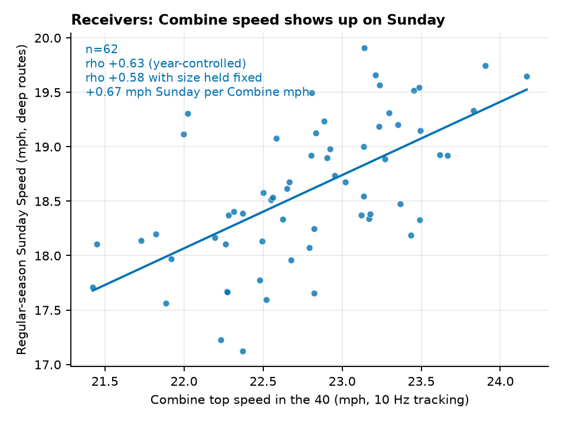
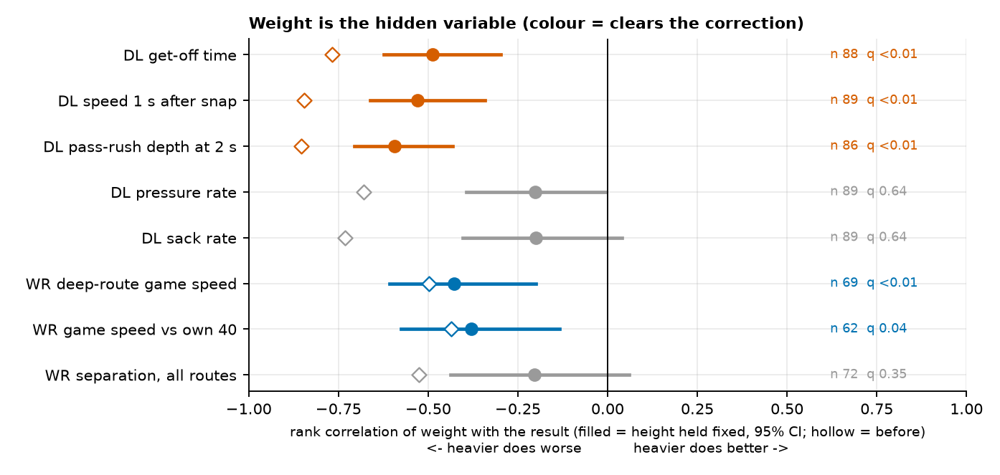
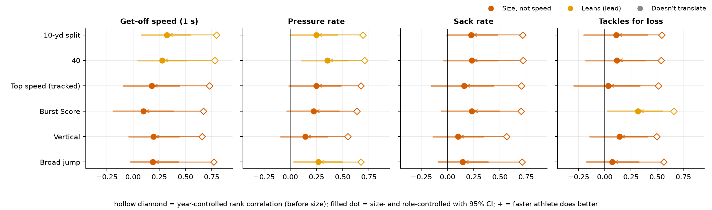
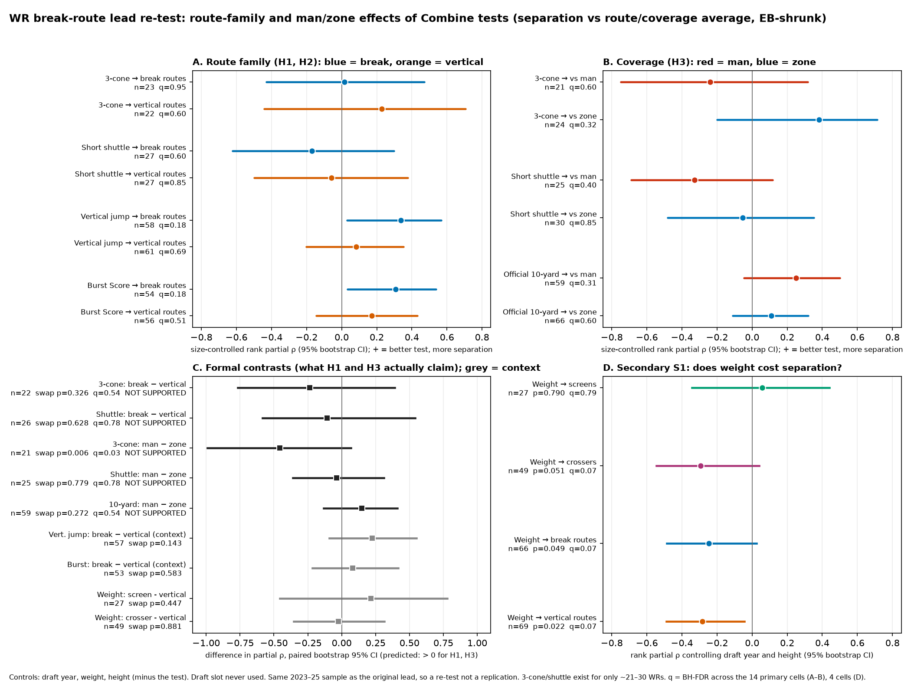
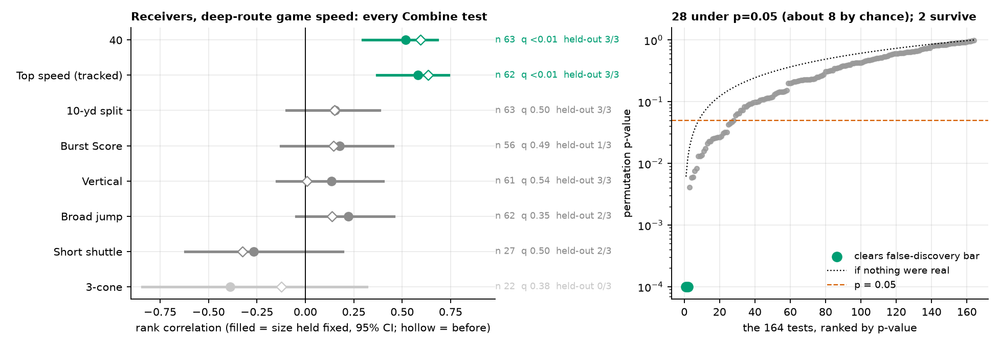
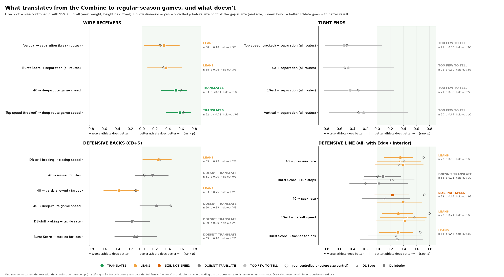

# Body size in a stopwatch costume: what the Combine really tells you about NFL play
*NFL Big Data Bowl 2027 · Open Track · Combine tracking linked to regular-season game tracking · WR, TE, DB, DL*

**Most Combine signal is body size wearing a stopwatch. Here is the one place speed is real, and where scouts get fooled.**

**The required link, stated plainly.** We connect each rookie's 10 Hz Combine tracking (2023 to 2025 classes) to his regular-season NFL game tracking and ask which Combine measures show up on Sundays. The link holds in one place. A receiver's tracked Combine top speed predicts his regular-season speed on deep routes (ρ +0.63 year-controlled, **+0.58 with body size held fixed**, n 62). The cell below recomputes that from the raw tracking files.

In four lines:
- **Weight is the hidden variable** behind defensive-line get-off and receiver game speed.
- **Defensive-line speed is mostly a mirage.** Hold size fixed and the link shrinks.
- **Agility drills do not do what scouts assume**, and defensive backs barely translate.
- **Receiver 40 and tracked top speed are the control.** They clear every check, so the method can find real signal.

## Data used
Competition files: `combine_tracking`, `game_tracking_2023/24/25`, `player_play`, `players`, `combine_results`, `games`. Two defensive-back outcomes (yards allowed per target, missed-tackle rate) come from free public Pro-Football-Reference season stats distributed through nflverse. We use no draft-position information; draft *year* is a control only. Running backs are excluded.

**Sunday Speed** is a player's 90th-percentile top speed per play on the plays his job asks for speed (deep routes for receivers, man or deep coverage for defensive backs), regular season only. **Burst Score** is a 0 to 100 within-position blend of the tracked 20-yard time and the jumps.

*Figure 1. Each dot is a receiver. Fast at the Combine means fast on deep routes on Sundays.*

## 1. Weight is the hidden variable
Heavier players are slower, and a stopwatch cannot tell weight from talent. Holding height and draft year fixed:

- **Defensive line.** Heavier linemen get off the ball slower (ρ -0.49, 95% CI -0.62 to -0.30, q <0.01) and reach a lower speed one second after the snap (-0.53, q <0.01).
- **Receivers.** Heavier receivers run slower on deep routes (-0.43, q <0.01) and slower than their own 40 predicts (-0.38, q 0.04).
- **Separation.** Heavier receivers also get less separation on break routes (-0.25), vertical routes (-0.28) and crossers (-0.29), but not on screens (+0.06). That is a lead, not a finding (q 0.07). It appears in Figure 4, panel D.

Weight does not move every outcome: pressure and sack rates are only weakly tied to it (-0.20, q 0.64). Where it matters, it is large, and it is why the next section exists.

*Figure 2. Weight against on-field results. Left of zero: heavier players do worse.*

## 2. Defensive-line speed is a mirage
The raw picture looks like a gift. Faster linemen get off quicker, rush the passer more and sack more. Across the four defensive-line outcomes with a strong raw link (get-off, pressure, sack, tackle for loss), 32 test-by-outcome cells have at least 25 players. Their median year-controlled link is ρ +0.68. Hold weight, height and role (edge or interior) fixed and the median falls to +0.21. 24 of the 32 earn **SIZE, NOT SPEED**: a real raw link that is really size.

- The 40 against **sack rate** goes from +0.72 to +0.23 (95% CI -0.04 to +0.48).
- The 40 against **pressure rate** goes from +0.71 to +0.35 (q 0.16). It survives as a lead.
- The 10-yard split against **get-off speed** goes from +0.80 to +0.32. It also survives as a lead.

Across all defensive-line cells with a raw link of at least 0.30, 32 of 33 lose half or more of it to size. None of the 6 receiver and defensive-back cells with a raw link that strong do.

**Where scouts get fooled:** a tackle who looks fast next to other big men still produces like a big man. Compare linemen only with linemen of the same weight.

*Figure 3. Defensive-line Combine tests, before and after holding size fixed. Arrows run from the raw link to the size-controlled link. 3-cone and shuttle (fewer than 36 linemen) are left out.*

## 3. Agility drills do not do what scouts assume
Before looking, we wrote down two beliefs and the tests that would kill them.

- **H1: the 3-cone and shuttle matter more on break routes than on vertical routes.** They do not. The break-minus-vertical difference is -0.24 for the 3-cone (95% CI -0.77 to +0.39) and -0.11 for the shuttle (-0.58 to +0.54). **Dead.**
- **H3: quickness matters more against man coverage than zone.** It does not. For the 10-yard split the man-minus-zone difference is +0.15 (CI -0.13 to +0.41). The 3-cone contrast points the *opposite* way (-0.46, n 21), and we do not trust it. **Dead.**

Only 22 to 30 receivers ran the 3-cone or shuttle, so a modest effect is not ruled out. The belief just has no support here.

What remains is a lead. A higher vertical jump (+0.34, n 58) and Burst Score (+0.31, n 54) go with more separation on break routes, with q 0.18. We cannot show they are specific to breaks (break-minus-vertical +0.23, CI -0.09 to +0.55). Treat it as something to test next season, not something to draft on.

*Figure 4. Pre-declared receiver tests. A and C: route family. B: man versus zone. D: weight by route type.*

## 4. Defensive backs: the Combine mostly does not translate
48 cornerback and safety cells have at least 25 players. 45 do not translate. 3 lean. None clears the false-discovery bar (lowest q 0.75). That is a clean null, and a useful one: a defensive back's Combine tests tell you little about his tackling, tackles for loss or deep-coverage speed.

One result runs the wrong way. A faster 40 goes with *more* yards allowed per target (-0.35, n 53, 95% CI -0.58 to -0.05), and broad jump agrees (-0.35). We read that as coverage role, not "speed hurts", and it does not clear correction.

| Combine test | Result | n | Year-controlled ρ | Size-controlled ρ (95% CI) | q | Verdict |
|---|---|---:|---:|---|---:|---|
| DB-drill braking (tracking) | Closing speed to the tackle | 69 | +0.27 | +0.25 (+0.01 to +0.45) | 0.79 | LEANS |
| 40-yard dash | Missed-tackle % (PFR) | 61 | +0.04 | +0.16 (-0.11 to +0.40) | 0.90 | DOESN'T TRANSLATE |
| 40-yard dash | Yards allowed per target (PFR) | 53 | -0.09 | -0.35 (-0.58 to -0.05) | 0.75 | LEANS |
| 40-yard dash | Game speed on deep routes (Sunday Speed) | 60 | +0.44 | +0.22 (-0.03 to +0.44) | 0.83 | DOESN'T TRANSLATE |
| DB-drill braking (tracking) | Tackle rate | 69 | -0.14 | -0.16 (-0.40 to +0.12) | 0.90 | DOESN'T TRANSLATE |
| Burst Score (tracking) | Tackles for loss | 53 | -0.07 | -0.12 (-0.42 to +0.23) | 0.96 | DOESN'T TRANSLATE |

*Table 1. Defensive backs, best test per result. + means a faster or better athlete does better, so a negative yards-allowed row means the wrong way.*

## 5. The control: where speed is real
If we only ever said "no", a skeptic could call the method a machine for rejecting things. Here is the test it has to pass.

We ran 164 Combine-by-outcome cells with at least 25 players. 28 reach p < 0.05, against about 8 expected by chance. The cells share players and related outcomes, so that excess overstates how many are independent findings. After false-discovery correction, **2 cells remain**, and both are receivers.

- **40-yard dash to deep-route game speed:** ρ +0.52 (95% CI +0.30 to +0.68, n 63, q <0.01).
- **Tracked Combine top speed to deep-route game speed:** ρ +0.58 (+0.37 to +0.74, n 62, q <0.01).

Both also improve predictions on draft classes the model never saw (3/3 held-out classes each). Straight-line speed is the one Combine trait that survives size control, correction and held-out validation. Everything else is a lead or a mirage; Figure 6 shows the full scorecard.

*Figure 5. Left: the receiver deep-route cells. Right: all 164 tests. Only the two receiver speed rows clear the bar.*

*Figure 6. The scorecard: best test per result and position group. Green means translates, orange leans, red size not speed, grey no translation.*

## Methods, in plain language
- **Size control.** Every link is repeated holding draft year (so a strong class cannot create a link), weight and height fixed, plus cornerback versus safety and edge versus interior where relevant. Hollow marks in the figures are the link before size.
- **Shrinkage.** Rates from few snaps are pulled toward the group average, so a hot 40-snap sample cannot top a list.
- **Held-out draft class.** Train on two classes, predict the third, and ask whether adding the Combine test beats a size-only model. We report how many of three classes improve.
- **False-discovery control.** Each p-value comes from 10,000 permutations, each interval from a player-level bootstrap, and each result carries a Benjamini-Hochberg q across its whole family of tests.
- **Pre-declaration.** Verdict rules and the receiver hypotheses were written down first.
- **Audit.** We re-checked every p-value and interval with a second method. The numbers here are the audited ones.

**Verdicts.** TRANSLATES: q below 0.05, interval excludes zero, same sign, held-out classes agree. LEANS: interval excludes zero or p below 0.05, but q does not clear. SIZE, NOT SPEED: raw link of at least 0.30 that falls by half or more and whose interval includes zero. TOO FEW: under 25 players. Otherwise DOESN'T TRANSLATE.

## How a scout uses this
A scorecard, not a ranking. It powers a lookup dashboard: enter a prospect's Combine line and each test returns its tag and a one-line read. Three lines from it:

- **A faster 40 shows up as faster game speed on deep routes. It holds after size control and on a held-out draft class (ρ +0.52, n 63).**
- **A faster 40 tends to go with a higher pressure rate (ρ +0.35, n 72), but it does not clear the false-discovery bar.**
- **A faster 40 goes with *more* yards allowed per target (ρ -0.35, n 53), and it does not clear the false-discovery bar.**

Each line carries its n and interval, so nobody mistakes a lean for a verdict. In practice: trust a receiver's 40 and tracked top speed, compare linemen only with linemen of their weight, and do not lean on a defensive back's 40.

## Limitations
- Rookies only: 2023 to 2025 classes, players who logged tracked snaps. Skipped drills are not random.
- Counts are small: receivers about 60, defensive backs about 70, linemen about 72, tight ends 21. Tight ends are all "too few to tell". "Doesn't translate" means no evidence, not proof of zero.
- The same players produced the leads and test them. The three held-out draft classes are the only out-of-sample check. Treat every LEANS row, including the defensive-line pressure lead and the break-route lead, as a hypothesis. Each position's Burst Score recipe was chosen using game results, so its numbers are optimistic.
- Pooled defensive-line size may partly mean role. Edge and interior splits have only 39 and 33 players.
- No blocker or quarterback tracks are linked, so pressure and sack results are association, not causation. Man versus zone is a team-level play label.

## Appendix
Code cells above are collapsed and show every calculation. The notebook reads the audited result tables from the `bdb2027-outputs` dataset and the raw competition files, which must be attached.
