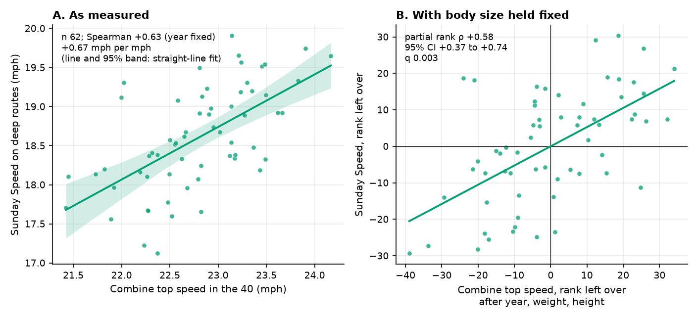
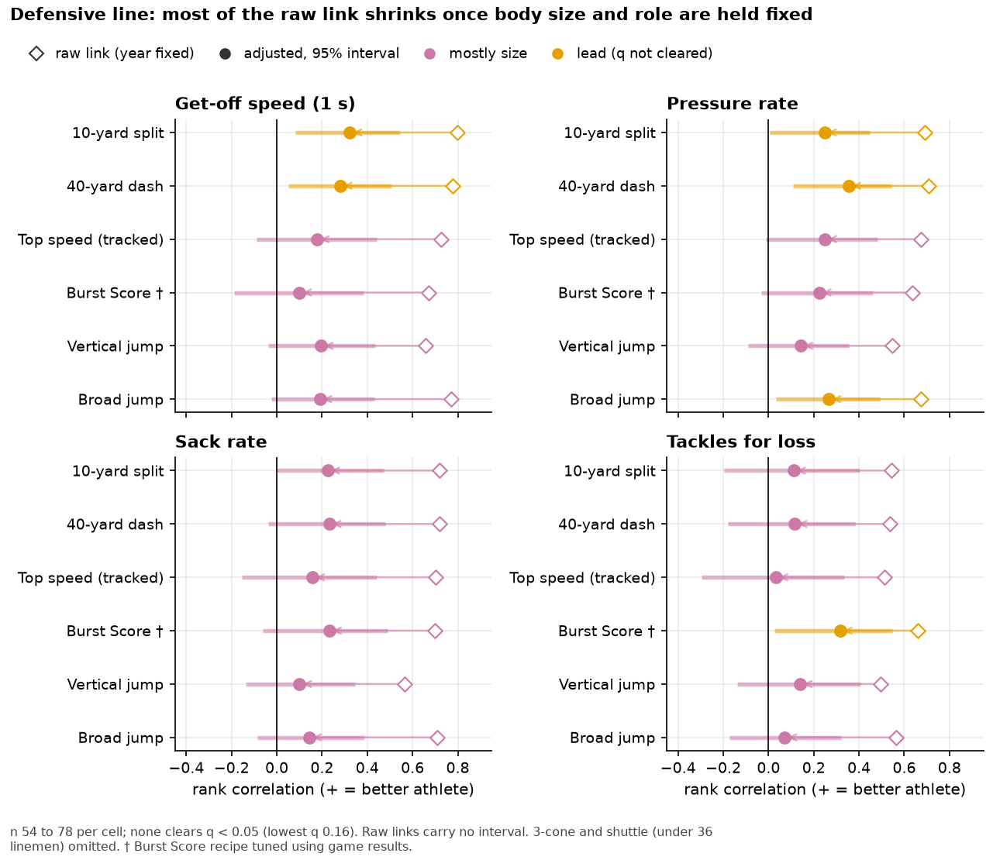
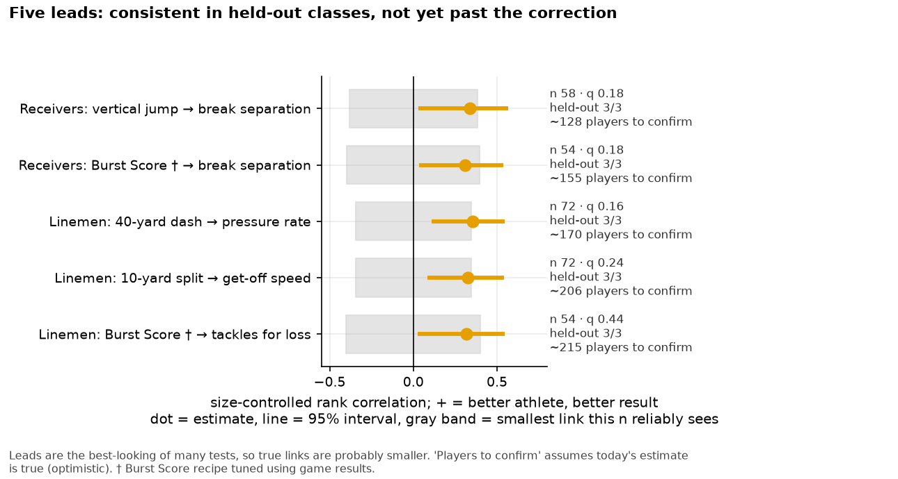
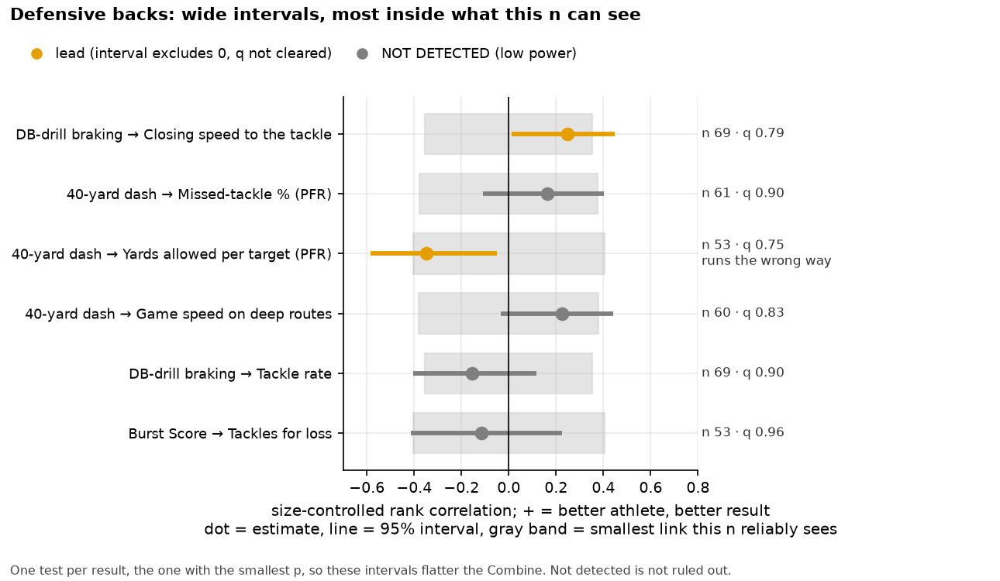
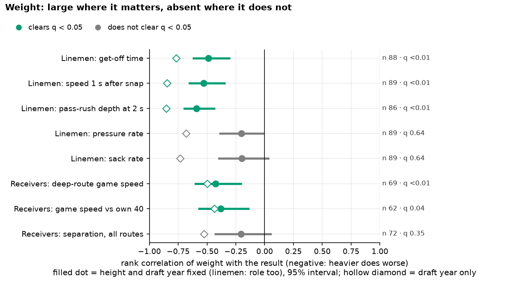
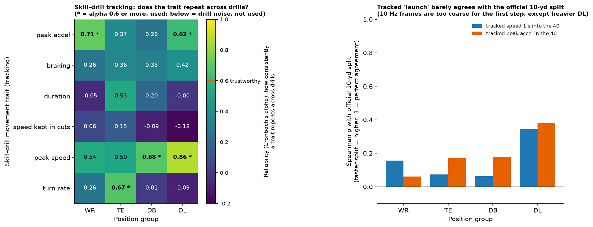
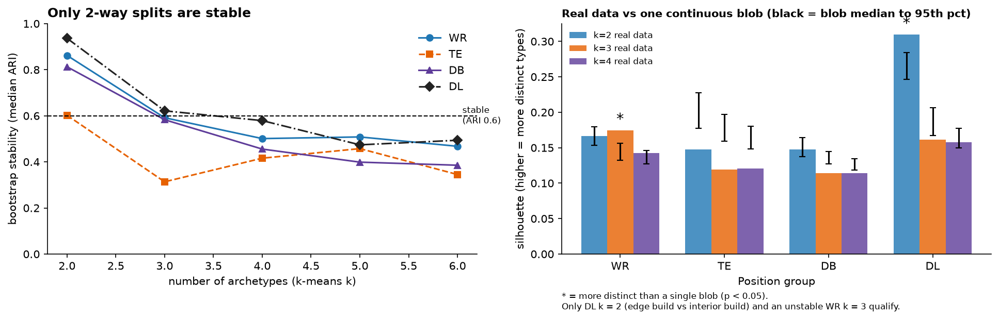
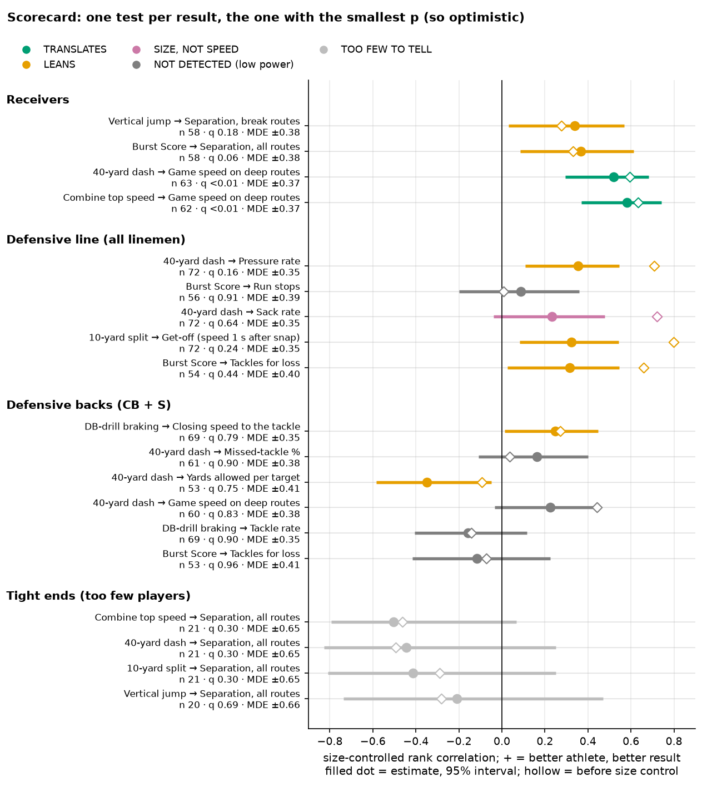

# Abstract

Does what a player shows at the NFL Scouting Combine show up on Sunday? We link 10 Hz Combine tracking and standard Combine results for rookie wide receivers (WR), tight ends (TE), defensive backs (DB; cornerbacks and safeties together) and defensive linemen (DL; edge and interior) from the 2023 to 2025 classes to their regular-season game tracking from the NFL Big Data Bowl 2027 data. Every Combine-to-game link is estimated twice: as a draft-year-controlled rank correlation, and as a rank partial correlation with weight, height, draft year and role held fixed. Noisy rate outcomes get empirical-Bayes beta-binomial shrinkage. Inference uses Freedman–Lane permutation p-values, player-level refit bootstraps, Benjamini–Hochberg false-discovery control within each position-group family, and leave-one-draft-class-out prediction checks. Each estimate also comes with its own minimum detectable effect (MDE). Five findings result. (1) Receiver straight-line speed carries over: tracked Combine top speed predicts regular-season speed on deep routes (ρ = +0.58 with size held fixed, 95% CI +0.37 to +0.74, n = 62, q < 0.01), and so does the 40-yard dash (+0.52, +0.30 to +0.68, n = 63). Both improve predictions in all three held-out draft classes. They are the only 2 of 164 adequately sized tests that clear false-discovery correction. (2) Defensive-line drills predict pass-rush outcomes, but mostly through body size: the median year-controlled link of +0.68 falls to +0.21 once weight, height and role are held fixed. (3) Five consistent leads hold in every held-out class but sit below what these samples can confirm. (4) Defensive-back links are NOT DETECTED (low power): with about 59 players, only correlations of 0.38 or more would be seen 8 times in 10. (5) Weight is the variable scouts must adjust for: heavier linemen get off the ball slower (ρ = −0.49) and heavier receivers run slower on deep routes (−0.43). An exploratory unsupervised analysis that never saw outcomes independently rediscovers the receiver speed axis. The message is not that the Combine fails. The Combine works, but it has to be read through body size and position.

**Keywords:** NFL Combine; player tracking; rank partial correlation; false discovery rate; statistical power; American football; scouting

# 1. Introduction

Every spring, NFL prospects run, jump and change direction at the Scouting Combine in front of every team's staff. Coaches and scouts then have to decide how much those numbers should count. The published record is mixed. Kuzmits and Adams [1] found no consistent relationship between Combine tests and early-career outcomes for quarterbacks and receivers, with sprint times for running backs the notable exception, and questioned the Combine's usefulness. Teramoto, Cross and Willick [2] found that, for receivers, vertical jump was associated with yards per reception and that height was the strongest predictor, concluding that the Combine has some predictive value. Vincent, Blissmer and Hatfield [3] reported at least one significant Combine–performance correlation at every position they studied, with Combine measures explaining between 4% and 62% of the variance in individual on-field variables. Cook, Ryan, Snarr and Rossi [4], analyzing 1,537 athletes, found mostly weak correlations with next-season game performance. In the sports-statistics literature, Mulholland and Jensen [5] modeled tight-end career success from pre-NFL information and found that size measures were over-emphasized relative to what predicted career success.

Two features of that literature motivate this paper. First, outcomes have usually been box-score or career totals (yards, games, snaps, salary). Those depend on usage, team context and opportunity as much as on athleticism, which dilutes any Combine signal. Second, body size is usually either ignored or entered as one more predictor, even though size moves both the stopwatch and the on-field result. A heavy interior lineman and a lighter edge rusher do not run the same 40 for the same reasons.

The NFL Big Data Bowl 2027 [6] makes a different design possible. It provides 10 Hz optical tracking of the Combine drills themselves and 10 Hz tracking of the same rookies in regular-season games. That lets us measure the same physical quality, such as top speed, at the Combine and on the field, and define outcomes at the play level: speed on deep routes, separation by route type, get-off after the snap, pressure rate.

We ask one question by position group: **which Combine measures, read with body size held fixed, show up in regular-season play, and how large an effect could this sample have seen at all?** The answer has three parts. Receiver speed is real and carries to Sunday. Defensive-line drills mostly measure size and role, so they have to be read size-adjusted. Defensive-back links cannot be detected at this sample size, which is not the same as showing they are absent. Throughout, a result that was not detected is reported with its MDE, so a reader can see what the sample could and could not have found.

# 2. Data

## 2.1 Competition data

All primary data come from the NFL Big Data Bowl 2027 competition on Kaggle [6], released under CC BY-NC 4.0. The data cover **510 rookies** who entered the league in the 2023, 2024 and 2025 classes. We use nine files:

- **Players and Combine results** (one row per player): listed position, draft year, height, weight, and the standard Combine tests (40-yard dash, 10-yard split, vertical jump, broad jump, 3-cone, short shuttle). Draft-position fields are present in the file but were never read. Draft *year* is used only as a control.
- **Combine tracking**: 10 Hz optical tracking of the Combine drills, with 463,189 frames across 6,310 drill attempts (40-yard dash, 3-cone, short shuttle and position skill drills), giving position, speed and acceleration magnitude.
- **Game tracking** for the 2023, 2024 and 2025 seasons: 10 Hz frames for the rookie cohort only (22.65 million frames in total), joined to **play-level data** (316,338 player-play rows: route run, separation at the throw, coverage assignment, pressure and get-off fields, tackles) and **game data** (1,002 games).

Only regular-season plays that were not nullified by penalty are used. Running backs are excluded. Offensive linemen and linebackers are outside the scope of this paper.

## 2.2 Outside data

Two defensive-back outcomes, yards allowed per target and missed-tackle percentage, come from public Pro-Football-Reference advanced defensive statistics [7], downloaded in 11/2026 through the free nflverse data releases [8] and matched by the nflverse player ID map. No other outside data enter any reported result. Both sources are free and public, in line with the competition's outside-data rule.

## 2.3 Outcomes

Outcomes are chosen so that the better athlete would be expected to do better, and are oriented so that a positive correlation means the more athletic test result goes with the better on-field result.

- **Sunday Speed** (WR, DB): the 90th percentile of a player's per-play top speed on plays where his job asks for speed. For receivers that is deep routes (go, post, corner, wheel; at least 20 such routes). For defensive backs it is pass plays in man or deep coverage (at least 30). The 90th percentile is used instead of the single fastest frame so that one tracking glitch or one unusual play cannot set the value.
- **Separation** (WR, TE): separation at the throw, minus the average for that route type, averaged over the player's routes, overall and on break routes. It is empirical-Bayes shrunk (normal–normal) toward the group mean.
- **DL outcomes** over regular-season pass snaps lined up at edge or interior line (at least 20): pressure rate (share of snaps with a recorded time to pressure), sack rate, tackles for loss, run stops, and get-off, defined as the median speed 1.0 second after the snap.
- **DB outcomes**: tackle rate, closing speed to the tackle, and the two Pro-Football-Reference outcomes above.

Rate outcomes with few opportunities are noisy, so pressure, sack, tackle-for-loss, run-stop and tackle rates use empirical-Bayes **beta-binomial shrinkage**. A Beta(α, β) prior is fit by marginal likelihood within each role, and each player's rate is the posterior mean (α + k)/(α + β + n). The unshrunk rate is kept as a sensitivity check.

## 2.4 Combine measures

The standard tests are used as reported. From the Combine tracking we derive **Combine top speed** (the highest tracked speed in any 40-yard-dash attempt), a **Burst Score** (a 0–100 within-position blend of the tracked 20-yard time and the jumps), and, for DBs, two skill-drill measures (braking and re-burst). Weight and height are treated as **size controls**, never as athletic tests.

## 2.5 Sample sizes

Samples are small because each player needs both a Combine measure and enough regular-season opportunity. Typical counts per test are about 62 receivers, 59 defensive backs, 64 defensive linemen (about 38 edge and 33 interior), and about 20 tight ends. The full grid has 208 group × test × outcome cells, 164 of them with at least 25 players.

# 3. Methods

All analysis code is in the public Kaggle notebook (Section 11). The verdict rules, the receiver route hypotheses and the unsupervised plan were written down before the corresponding outcomes were examined.

## 3.1 Two correlations for every link

For each group, Combine test and outcome we report two rank correlations.

1. **Year-controlled ("raw") correlation.** Both the test and the outcome are demeaned within draft-year cells, and the Spearman correlation of the residuals is computed. This removes the fact that a 2023 rookie has had three seasons and a 2025 rookie one.
2. **Size-controlled correlation.** A rank partial correlation holding draft year, weight and height fixed, plus role where it applies (cornerback versus safety; edge versus interior). This answers the scout's real question: among players of the same size and role, does the better tester do better?

Both are computed on the same outcome scale. The share of the raw link that disappears under size control is reported as a descriptive split, not as a causal decomposition.

## 3.2 Inference

- **p-values** come from Freedman–Lane permutation tests [9]: residuals of the reduced (controls-only) model are permuted 10,000 times. The smallest attainable p is about 0.0001. An independent audit re-derived all 208 cells with 20,000 permutations and an analytic t test. Permutation and audit p-values agree within Monte-Carlo noise (largest gap 0.015). Only the two receiver speed cells sit at the floor.
- **Confidence intervals** come from a player-level bootstrap with 2,000 resamples. Players, not plays, are resampled, and the full residualization is refit inside each resample. The audit repeated this with 5,000 resamples in percentile and bias-corrected and accelerated (BCa) form [10] and with a Fisher-z interval using the Bonett–Wright standard error for rank correlations [11]. The methods agree in sign everywhere and, with six borderline exceptions, on whether the interval excludes zero.
- **Multiple testing** uses Benjamini–Hochberg false-discovery control [12] within each position-group family: 273 cells each for all DL, edge and interior, 68 for WR, 34 for TE and 152 for DB, plus a separate pre-declared 14-cell family for receiver break-route hypotheses. The q-value always comes from the full family, so showing the best test per outcome later does not flatter its verdict.
- **Calibration.** A simulation of the actual code under the null with a size confounder (n = 25, 40, 70) gave permutation false-positive rates of 5.7%, 6.7% and 5.7% at p < 0.05.

## 3.3 Held-out draft classes

To check prediction out of sample, we train on two draft classes and predict the third, for each of the three classes in turn. A size-only ridge model (weight, height, plus role for DL) is compared with a size-plus-test model, both fit on within-class normal scores with a fixed penalty. We report the pooled out-of-sample gain in R², the number of held-out classes where the test helps, and a permutation p-value (test values shuffled within class, 1,000 permutations, with the full leave-one-class-out refit each time).

## 3.4 Power and minimum detectable effect

A result that is not detected is only informative if the sample could have detected something. For each cell with n players and k controls, the standard error on the Fisher-z scale is taken as $\mathrm{se} = \sqrt{1.06/(n-k-3)}$. The 1.06 factor is the usual large-sample variance inflation of a Spearman correlation over a Pearson correlation [13]. The MDE at 80% power is

$$\mathrm{MDE}_{80} = \tanh\!\big((z_{1-\alpha/2} + z_{0.80})\cdot \mathrm{se}\big),$$

computed at α = 0.05 two-sided, and again at the Benjamini–Hochberg threshold actually used in that family. Power to see a true ρ = 0.30 is computed the same way. A simulation of rank partial correlations with four controls (n = 21 to 64) gave 77% to 82% power at the analytic MDE, against the 80% target.

## 3.5 Verdict rules

Each cell receives exactly one verdict, under rules fixed before the scorecard was built.

- **TRANSLATES**: size-controlled bootstrap CI excludes zero; BH q < 0.05; raw and size-controlled signs agree; shrunk and unshrunk signs agree; the held-out gain is positive with permutation p < 0.10 and appears in at least 2 of 3 classes.
- **LEANS**: size-controlled CI excludes zero *or* permutation p < 0.05, same sign as raw, but q ≥ 0.05.
- **SIZE, NOT SPEED**: a raw link of at least 0.30 that falls by half or more once size and role are held fixed.
- **TOO FEW TO TELL**: fewer than 25 players.
- **NOT DETECTED (low power)**: none of the above. No link larger than the cell's MDE was seen. This is not evidence of no link.

# 4. Results

Of the 164 cells with at least 25 players, 28 reach p < 0.05, against about 8 expected by chance. Because cells share players, that excess overstates the number of independent findings. After false-discovery correction exactly 2 remain, and both are receiver speed.

## 4.1 Finding 1: receiver speed is real, and it carries to Sunday

Two Combine measures clear every check, and both measure receiver straight-line speed. Tracked Combine top speed predicts Sunday Speed on deep routes at ρ = +0.63 year-controlled and **+0.58 with weight and height held fixed** (95% CI +0.37 to +0.74, n = 62, q < 0.01). The official 40-yard dash goes from +0.59 to +0.52 (95% CI +0.30 to +0.68, n = 63, q < 0.01). Both improve prediction in all three held-out draft classes, with pooled out-of-sample R² gains of 0.25 for top speed and 0.20 for the 40.

Expressed as an exchange rate, each extra mph of Combine top speed goes with about **0.67 mph** more speed on deep routes in games (95% bootstrap CI 0.47 to 0.88). Size barely moves the receiver link, which is the opposite of what happens on the defensive line. For defensive backs the same exchange rate is indistinguishable from zero (cornerbacks 0.09, CI −0.13 to 0.38; safeties 0.22, CI −0.17 to 0.59).

{width=95%}

The other receiver tests (10-yard split, jumps, shuttle, Burst Score) were not detected against deep-route speed. Detecting them would have needed a correlation of about 0.37 or more. Figure 2 shows why the two speed rows can be trusted: among all 164 adequately sized tests, the method does not produce a crowd of marginal discoveries. It isolates the two that are real.

{width=88%}

## 4.2 Finding 2: defensive-line drills predict pass rush, mostly through body size

Faster linemen get off the ball quicker, pressure more and sack more, but much of that is body size and role. Across the 32 defensive-line cells with at least 25 players that pair a test with get-off, pressure, sack or tackles for loss, the median year-controlled link is ρ = +0.68. With weight, height and role held fixed it is **+0.21**. About 69% of the raw link is shared with size and role. That is a statistical split, not proof of cause.

What remains is still positive:

- 40-yard dash against **pressure rate**: +0.71 raw, +0.35 size-controlled (95% CI +0.11 to +0.54, q = 0.16).
- 10-yard split against **get-off**: +0.80 raw, +0.32 size-controlled (q = 0.24).
- 40-yard dash against **sack rate**: +0.72 raw, +0.23 size-controlled, with an interval (−0.04 to +0.48) that now touches zero.

The pressure lean appears separately for edge (+0.35, n = 39) and interior (+0.40, n = 33) rushers, so it is not only the edge-versus-interior gap. Of the 33 defensive-line cells with a raw link of at least 0.30, 32 lose half or more of it to size and role. None of the 6 comparable receiver or defensive-back cells do.

{width=90%}

## 4.3 Finding 3: consistent leads that need more seasons

Five results help in every held-out draft class (3 of 3) but do not clear the false-discovery bar. We report them as **leads**:

- **Receivers.** A higher vertical jump (+0.34, n = 58, q = 0.18) and a higher Burst Score (+0.31, n = 54, q = 0.18) go with more separation on break routes.
- **Defensive line.** The 40 goes with pressure rate (+0.35, q = 0.16), the 10-yard split with get-off (+0.32, q = 0.24), and Burst Score with tackles for loss (+0.32, q = 0.44).

Each estimate is at or below what these samples reliably detect even before correction (about 0.37 for receivers and for linemen), and well below what correction demands (about 0.51 and 0.56). If the true links equal today's estimates, confirming them would take roughly 4 to 9 more draft classes. That projection is optimistic, because the leads are by construction the best-looking tests.

The textbook agility story was not detected. We pre-declared that 3-cone and shuttle would matter more on break routes than on vertical routes (observed differences −0.24 and −0.11, intervals include zero), and that quickness would matter more against man than zone coverage (10-yard split difference +0.15, CI −0.13 to +0.41). Only 22 to 29 receivers ran those drills, so only effects of about 0.57 or more were visible. Not detected is not ruled out.

{width=90%}

## 4.4 Finding 4: defensive backs are NOT DETECTED (low power)

Forty-eight cornerback and safety cells have at least 25 players. Forty-five are NOT DETECTED (low power) and 3 lean. None clears correction (lowest q = 0.75). This is a power problem, not evidence that the Combine is uninformative for defensive backs. With about 59 players, only links of ρ = 0.38 or more would be seen 8 times in 10, and a true link of 0.30 would be seen only 57% of the time, or 7% after correction (Table 1).

| Group | Typical n | Smallest ρ seen 8 times in 10 | …after correction | Power at true ρ = 0.30 | …after correction |
|----------------------|------:|--------:|--------:|--------:|--------:|
| Receivers | 62 | 0.37 | 0.51 | 61% | 18% |
| Defensive line, all | 64 | 0.37 | 0.56 | 61% | 7% |
| Edge only | 38 | 0.48 | 0.69 | 39% | 2% |
| Interior only | 33 | 0.51 | 0.73 | 33% | 1% |
| Defensive backs | 59 | 0.38 | 0.56 | 57% | 7% |
| Tight ends (n ≥ 15) | 20 | 0.66 | 0.81 | 20% | 2% |

Table: **Table 1.** What each sample can see: the minimum detectable effect at 80% power, before and after Benjamini–Hochberg correction, and the power to detect a true correlation of 0.30. Medians over tests with at least 25 players (tight ends: at least 15).

The intervals are wide. The 40 against missed-tackle rate is +0.16 (CI −0.11 to +0.40). DB-drill braking against tackle rate is −0.16 (−0.40 to +0.12). One result runs the other way: a faster 40 goes with *more* yards allowed per target (ρ = −0.35, n = 53, CI −0.58 to −0.05), and broad jump agrees (−0.35). We read that as coverage role, not "speed hurts," and it does not clear correction.

{width=88%}

## 4.5 Finding 5: weight is the variable scouts must adjust for

A stopwatch cannot separate weight from talent. Holding height and draft year fixed (and role for linemen):

- **Defensive line.** Heavier linemen get off the ball slower (ρ = −0.49, 95% CI −0.62 to −0.30, q < 0.01) and reach a lower speed one second after the snap (−0.53, q < 0.01).
- **Receivers.** Heavier receivers run slower on deep routes (−0.43, q < 0.01) and slower than their own 40 predicts (−0.38, q = 0.04).
- **Separation.** Heavier receivers also get less separation on break (−0.25), vertical (−0.28) and crossing (−0.29) routes, but not on screens (+0.06). That pattern is a lead (q = 0.07).

Weight does not move everything: pressure rate is only weakly tied to it (−0.20, q = 0.64). Scouts already adjust a 40 for weight by feel. These numbers say by how much.

{width=88%}

## 4.6 Every result at a glance

Table 2 gives the verdict for every one of the 208 group × test × outcome cells. Only the two receiver speed cells reach TRANSLATES. All 25 SIZE, NOT SPEED cells are defensive line, and most defensive-back and edge or interior cells are NOT DETECTED (low power).

| Group | TRANSLATES | LEANS | SIZE, NOT SPEED | NOT DETECTED (low power) | TOO FEW TO TELL | Total |
|------------------------|--------:|--------:|--------:|--------:|--------:|------:|
| Receivers | 2 | 4 | 0 | 11 | 3 | 20 |
| Tight ends | 0 | 0 | 0 | 0 | 8 | 8 |
| Defensive backs | 0 | 3 | 0 | 45 | 12 | 60 |
| Defensive line, all | 0 | 6 | 24 | 6 | 4 | 40 |
| Defensive line, edge | 0 | 7 | 0 | 23 | 10 | 40 |
| Defensive line, interior | 0 | 6 | 1 | 22 | 11 | 40 |
| **All** | **2** | **26** | **25** | **107** | **48** | **208** |

Table: **Table 2.** Verdicts for every group × Combine test × outcome cell in the scorecard.

# 5. Exploratory unsupervised analysis

The confirmatory analysis above tests named Combine measures against named outcomes. To look for structure we might have missed, we ran a separate unsupervised track. Its plan, including features, methods, families of outcome links and labels, was written before any outcome was looked at. Results added afterward are labeled **post hoc** and treated as leads only.

**Features and dimension reduction.** Within each position group, standard Combine results and reliable tracking features were standardized. Players with at least 60% of features observed were kept (34 to 99 per group), and the remaining gaps were filled by iterative imputation. The 3-cone, short shuttle and bench press were excluded because 55% to 80% of each group was missing. Principal component analysis (PCA) kept components by Horn's parallel analysis [14]. At WR, three components explaining 25%, 18% and 15% of the variance were kept. t-SNE [15] was used only for pictures, never for inference.

**Drill reliability came first.** Before clustering, we checked whether each skill-drill movement trait repeats across a position's drills (Cronbach's α [16] over 8 to 13 drills). Peak speed repeats (DL α = 0.86, DB 0.68), and so does WR peak acceleration (0.71). Braking, speed kept through cuts, turn rate and drill duration mostly do not (α between −0.18 and 0.42). The one exception is tight-end turn rate (0.67). The tracked first second of the 40 barely agrees with the official 10-yard split at WR, TE and DB (ρ between 0.06 and 0.18). At 10 frames per second, the tracked 10-yard time can only be 1.9 s or 2.0 s for most players. Tracked top speed, by contrast, agrees with our main-analysis version at 0.96 to 0.99. Unreliable traits were left out, which is why the confirmatory analysis does not build on tracked first-step or cut metrics.

{width=100%}

**There are no hidden Combine "types" outside the defensive line.** We tried k-means, Gaussian mixtures, Ward clustering and HDBSCAN [17], and judged stability by the bootstrap adjusted Rand index (ARI) [18]. Only two-group splits were stable (median ARI 0.60 to 0.94). Every solution with three or more groups fell apart under resampling. More importantly, at WR, TE and DB even the stable two-group split was no more distinct than cutting a single continuous blob in half (one-blob test p from 0.19 to 0.86). The defensive line is the exception. Its two-group split (silhouette 0.31 against a one-blob 95th percentile of 0.285, p = 0.01, bootstrap ARI 0.94) is essentially a lean edge build against a heavy interior build (ARI with the edge/interior label 0.69). HDBSCAN found no dense clusters in any group. A receiver is not a "burner" or a "possession" type at the Combine. He sits somewhere on a sliding scale of size against speed.

{width=100%}

**Blind rediscovery of receiver speed.** The third WR principal component, which loads on the 40, tracked top speed, broad jump and vertical, predicts deep-route game speed with size held fixed (ρ = +0.50, 95% CI +0.27 to +0.66, n = 63, q = 0.004). It also holds on held-out classes (ρ = +0.44, p = 0.001, 3 of 3 classes). A search that never saw an outcome found the same signal as Finding 1. That makes it an independent confirmation, not a new insight. Post hoc, holding tracked top speed fixed drops it to +0.22 (−0.06 to +0.47).

**Exploratory leads, labeled as such.**

- Defensive linemen who test "fast for their size" pressure more: median pressure rate 8.3% against 6.8% (n = 48 against 24) with size and role held fixed (p = 0.011, q = 0.17; held-out ρ = +0.23, 3 of 3). The overall-athleticism component (lighter, faster, jumps) shows the same pattern (+0.30, q = 0.17) and is the best held-out predictor in the unsupervised track (+0.56, 3 of 3). Post hoc, though, the 40 alone does as well (+0.36 on the same 65 players). Read it as support for the DL 40 lead, not as a new test.
- *Post hoc:* at the same height, heavier rookie receivers run fewer deep routes (ρ = −0.32, CI −0.49 to −0.08, q = 0.046) and more short ones (+0.25, q = 0.12). This concerns how players are deployed, not how well they play, and it was not checked on held-out classes.
- Whole-profile associations between Combine shape and in-game movement style exist in every group (RV coefficient [19] 0.19 for WR, 0.18 for DB and 0.64 for DL, all q ≤ 0.003). At DB and DL, however, they mostly reflect role: cornerback against safety, edge against interior.

**What was not detected.** "Heavy but explosive" linemen (weight × jumps; pressure interaction p = 0.16, q = 0.44), "slow 40 but elite burst" receivers (all q ≥ 0.44), unusual Combine profiles found by isolation forest [20] (no reliable link in any group), and any DB archetype, axis or anomaly link (all size-controlled q ≥ 0.31) were NOT DETECTED (low power). Tight-end archetype tests are TOO FEW TO TELL (n = 18 to 21; MDE η² about 0.30).

# 6. Discussion: the Combine works, but read it right

These results support a simple reading: the Combine measures some things very well, and it has to be read through body size and position.

**Speed is a skill that travels for receivers.** A receiver's tracked top speed at the Combine is one of the clearest pre-NFL signals in this data: it survives size control, false-discovery correction, an independent audit, held-out classes and a blind unsupervised search. That matches the intuitive view that deep speed is hard to fake. The 10 Hz tracking adds something the stopwatch does not: a direct measurement of the same quantity (top speed) at the Combine and in games.

**Line drills are honest, but they are mostly measuring the body.** Scouts know that a lean edge rusher and a heavy interior lineman should not be compared on the same 40. The data put a number on that intuition: about 69% of the defensive-line Combine-to-game link is shared with weight, height and role. What remains, a size-adjusted 40 or 10-yard split, still leans toward more pressure and quicker get-off, in both edge and interior rushers. "Fast for his size" is the right reading. "Fast" is not.

**Defensive backs are a sample-size problem.** Defensive-back results were not detected, and the power analysis shows why: with about 59 players per test, a moderate true link of 0.30 would be missed more than 4 times in 10 even before correction. The wide intervals are compatible with useful links and with none. The one negative result, a faster 40 going with more yards allowed per target, is more plausibly about assignment than about speed hurting coverage, and it does not survive correction.

**Weight is the confounder to adjust for.** Weight slows linemen's get-off and receivers' deep speed, and heavier receivers separate less on most route types. Any reading of a raw Combine number that ignores weight will partly be reading weight.

**Why our conclusions differ in tone from parts of the literature.** Earlier studies that found little Combine signal [1, 4] mostly used outcomes such as yards, games, snaps or salary, which also depend on opportunity and usage. When the outcome is the same physical quality measured in games (speed on deep routes, get-off after the snap), the link is much clearer. And when the sample is small, a null should be reported as "not detected" with an MDE, not as "no effect."

# 7. Limitations

- **Rookies only, small samples.** Only the 2023 to 2025 classes with tracked regular-season snaps are included. Typical counts are about 62 receivers, 59 defensive backs, 64 linemen and 20 tight ends. Tight-end results are too few to tell (MDE about 0.66; 20% power at 0.30).
- **Missing drills are not random.** Players choose whether to run the 3-cone and shuttle. Only 22 to 29 receivers have them.
- **Same players, same data.** The leads were found and tested on the same players. The three held-out draft classes are the only out-of-sample check, and they are not an independent replication. The Burst Score recipe was chosen using game results, and Figures 5 and 9 show the best-looking test per outcome, so those estimates are optimistic.
- **Role and size overlap.** Pooled defensive-line size effects partly reflect role. The edge and interior splits have only about 39 and 33 players (MDE about 0.48 and 0.51).
- **Association, not causation.** Blockers and quarterbacks are not in the rookie tracking, so pressure and sack results are associations. The share of a link that is "explained by size" is a statistical decomposition, not a causal one.
- **Outcome measurement.** Sunday Speed and separation depend on route and coverage mix. We adjust by route type, require play floors and shrink noisy estimates, but deployment still differs between players. Two DB outcomes come from Pro-Football-Reference charting, with its own measurement error.
- **Tracking resolution.** At 10 Hz, first-step and cut metrics are too coarse to be reliable, so we do not use them.

# 8. Practical use for scouts

The findings translate into a scorecard rather than a ranking (Figure 9). Each Combine test for each group gets one tag (TRANSLATES, LEANS, SIZE NOT SPEED, NOT DETECTED (low power) or TOO FEW TO TELL), the sample size, the interval, the MDE and a one-line read, for example:

> *A faster 40 shows up as faster game speed on deep routes. It holds after size control and on a held-out draft class (ρ +0.52, n 63).*

Behind the scorecard, a lookup tool takes a Combine line and returns, for each test, an expected game value with an 80% prediction range for a new player. The range is t(0.90, df) · sd · √(1 + 1/n + z′Cz), so it widens for unusual size or test values. In leave-one-out checks, these ranges covered 78% to 87% of players against an 80% target.

Rules of thumb:

1. **Trust a receiver's 40 and tracked top speed.** They carry to deep-route speed on Sunday at about 0.67 mph per Combine mph.
2. **Compare linemen only with linemen of their weight and role.** A raw 40 mostly tells you size. A size-adjusted 40 or 10-yard split leans toward more pressure and quicker get-off.
3. **Adjust every speed number for weight.** Heavier players are slower in games by an amount the data now quantify.
4. **Treat defensive-back Combine numbers as one input beside tape and role.** Not detected at this sample size does not mean irrelevant.
5. **Trust tracked top speed and drill peak speed. Do not scout off tracked first-step, braking or cut metrics,** which do not repeat from drill to drill.
6. **Read every line with its n and interval.** A gray row means "not seen above this size," not "zero."

{width=100%}

# 9. Conclusion

Linking 10 Hz Combine tracking to 10 Hz regular-season tracking shows a Combine that works when it is read correctly. Receiver straight-line speed is a real, transferable skill: tracked top speed predicts deep-route speed on Sunday with body size held fixed, in every held-out class, and it is the strongest pattern even an outcome-blind search finds. Defensive-line drills predict pass rush, but mostly because they measure body size and role, so they have to be read size-adjusted. Defensive-back links were not detected at this sample size, and every such result here comes with the effect size the sample could have seen. Weight is the variable that ties these findings together. Every additional draft class of tracked rookies will tighten these intervals. The leads identified here, receiver jumps against break-route separation and the size-adjusted defensive-line 40 against pressure, are the first to test.

# 10. Ethics, privacy and rules

No draft-position information is used anywhere. No player is named or compared with another player, and only aggregate results are reported. No raw competition data are redistributed.

# 11. Data and code availability

- **Public analysis notebook (Kaggle):** <https://www.kaggle.com/code/kevinpolymath/read-the-combine-through-body-size>. It reruns the main analysis from the competition data, recomputes the required Combine-tracking-to-game link, and generates all seven main figures.
- **Public results dataset (Kaggle):** <https://www.kaggle.com/datasets/kevinpolymath/bdb2027-outputs>. It contains aggregate scorecard tables (208-cell full grid, displayed scorecard, weight table) and one figure. It has no player-level rows and no raw competition data. License: CC BY-NC 4.0.
- **Competition data:** available to registered participants from the NFL Big Data Bowl 2027 Kaggle page [6] under its terms. It is not redistributed here.
- **Outside data:** Pro-Football-Reference advanced defensive statistics via nflverse [7, 8].

# References

[1] Kuzmits, F. E., & Adams, A. J. (2008). The NFL Combine: Does it predict performance in the National Football League? *Journal of Strength and Conditioning Research*, 22(6), 1721–1727. https://doi.org/10.1519/JSC.0b013e318185f09d

[2] Teramoto, M., Cross, C. L., & Willick, S. E. (2016). Predictive value of National Football League Scouting Combine on future performance of running backs and wide receivers. *Journal of Strength and Conditioning Research*, 30(5), 1379–1390. https://doi.org/10.1519/JSC.0000000000001202

[3] Vincent, L. M., Blissmer, B. J., & Hatfield, D. L. (2019). National Scouting Combine scores as performance predictors in the National Football League. *Journal of Strength and Conditioning Research*, 33(1), 104–111. PubMed ID 30358695.

[4] Cook, J., Ryan, G. A., Snarr, R. L., & Rossi, S. (2020). The relationship between the National Football League Scouting Combine and game performance over a 5-year period. *Journal of Strength and Conditioning Research*, 34(9), 2492–2499. https://doi.org/10.1519/JSC.0000000000003676

[5] Mulholland, J., & Jensen, S. T. (2014). Predicting the draft and career success of tight ends in the National Football League. *Journal of Quantitative Analysis in Sports*, 10(4), 381–396. https://doi.org/10.1515/jqas-2013-0134

[6] NFL Big Data Bowl 2027. Kaggle competition. https://www.kaggle.com/competitions/nfl-big-data-bowl-2027 (data accessed 10/2026).

[7] Pro-Football-Reference. Advanced defensive statistics. https://www.pro-football-reference.com/ (accessed 11/2026 via [8]).

[8] nflverse. nflverse-data releases: pfr_advstats and players. https://github.com/nflverse/nflverse-data (accessed 11/2026).

[9] Freedman, D., & Lane, D. (1983). A nonstochastic interpretation of reported significance levels. *Journal of Business & Economic Statistics*, 1(4), 292–298. https://doi.org/10.1080/07350015.1983.10509354

[10] Efron, B. (1987). Better bootstrap confidence intervals. *Journal of the American Statistical Association*, 82(397), 171–185. https://doi.org/10.1080/01621459.1987.10478410

[11] Bonett, D. G., & Wright, T. A. (2000). Sample size requirements for estimating Pearson, Kendall and Spearman correlations. *Psychometrika*, 65(1), 23–28. https://doi.org/10.1007/BF02294183

[12] Benjamini, Y., & Hochberg, Y. (1995). Controlling the false discovery rate: A practical and powerful approach to multiple testing. *Journal of the Royal Statistical Society: Series B (Methodological)*, 57(1), 289–300. https://doi.org/10.1111/j.2517-6161.1995.tb02031.x

[13] Fieller, E. C., Hartley, H. O., & Pearson, E. S. (1957). Tests for rank correlation coefficients. I. *Biometrika*, 44(3–4), 470–481. https://doi.org/10.1093/biomet/44.3-4.470

[14] Horn, J. L. (1965). A rationale and test for the number of factors in factor analysis. *Psychometrika*, 30(2), 179–185. https://doi.org/10.1007/BF02289447

[15] van der Maaten, L., & Hinton, G. (2008). Visualizing data using t-SNE. *Journal of Machine Learning Research*, 9, 2579–2605.

[16] Cronbach, L. J. (1951). Coefficient alpha and the internal structure of tests. *Psychometrika*, 16(3), 297–334.

[17] Campello, R. J. G. B., Moulavi, D., & Sander, J. (2013). Density-based clustering based on hierarchical density estimates. In *Advances in Knowledge Discovery and Data Mining (PAKDD 2013)*, LNAI 7819, 160–172. https://doi.org/10.1007/978-3-642-37456-2_14

[18] Hubert, L., & Arabie, P. (1985). Comparing partitions. *Journal of Classification*, 2, 193–218. https://doi.org/10.1007/BF01908075

[19] Robert, P., & Escoufier, Y. (1976). A unifying tool for linear multivariate statistical methods: The RV-coefficient. *Journal of the Royal Statistical Society: Series C (Applied Statistics)*, 25(3), 257–265. https://doi.org/10.2307/2347233

[20] Liu, F. T., Ting, K. M., & Zhou, Z.-H. (2008). Isolation forest. In *Proceedings of the 8th IEEE International Conference on Data Mining (ICDM 2008)*, 413–422. https://doi.org/10.1109/ICDM.2008.17
