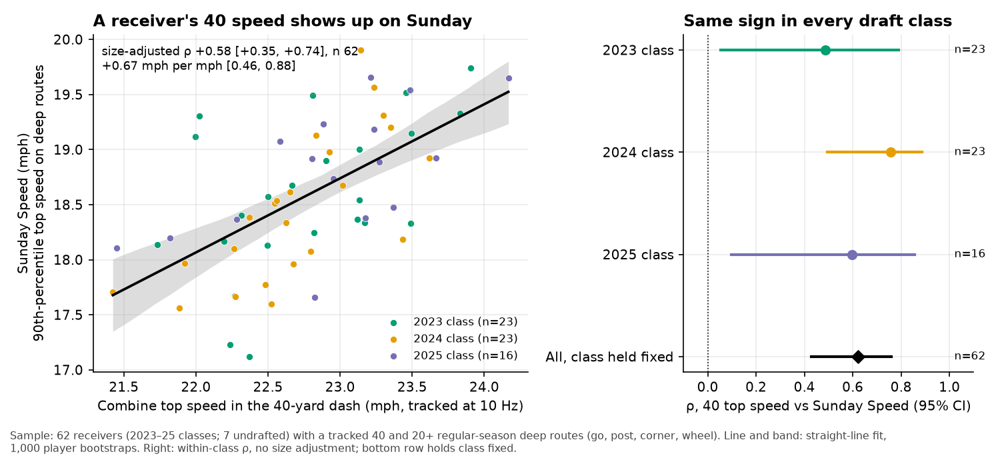
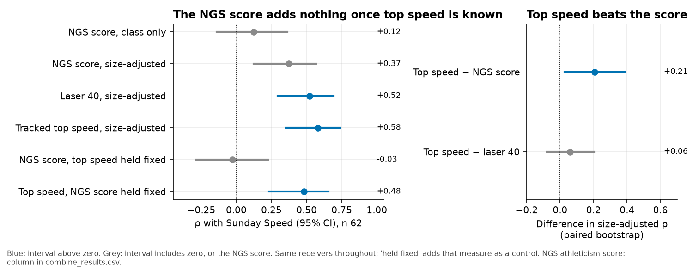
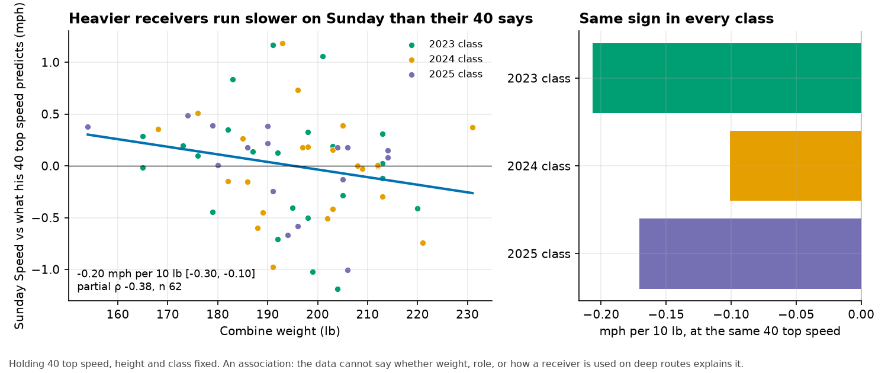
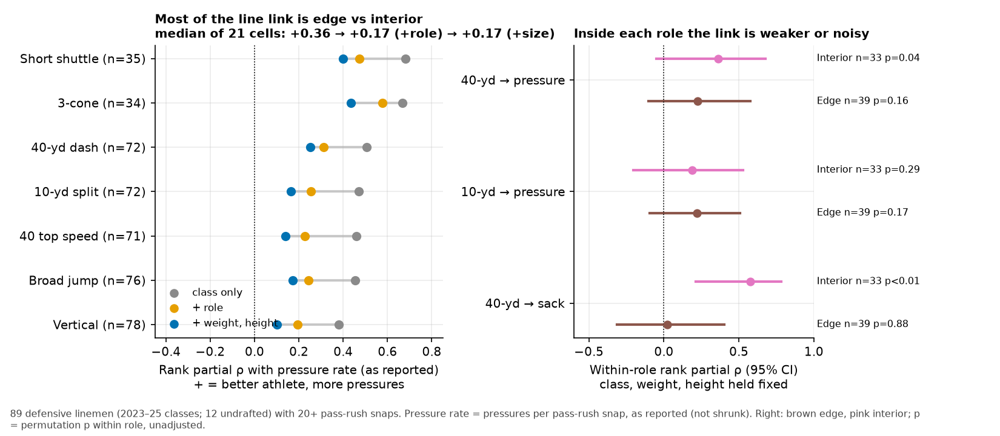
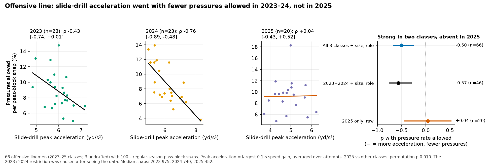
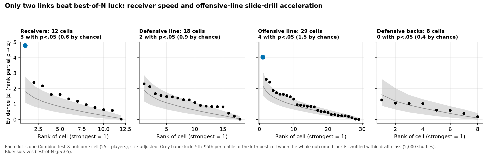

# Does the Combine Carry to Sunday? Receiver speed does; the NFL's athleticism score doesn't add to it
*NFL Big Data Bowl 2027 · Open Track · Combine tracking linked to regular-season game tracking · WR, DL, OL, DB*

**Four findings, the surprising ones first.**
1. **The NFL's athleticism score adds nothing once tracked Combine top speed is known.** For receivers, the NGS athleticism score has a partial correlation of −0.03 with game speed given top speed; top speed given the score is +0.48. Top speed beats the score by +0.51 (95% CI +0.25 to +0.75).
2. **Heavier receivers play slower than their own 40 says.** At the same Combine top speed, each extra 10 lb goes with 0.20 mph less top speed on deep routes (CI −0.30 to −0.09), with the same sign in all three draft classes.
3. **An offensive-line drill result reversed.** Peak acceleration in the 5-yard slide drill goes with fewer pressures allowed (ρ −0.49, n 66). It survives the multiple-testing correction, holds in the 2023 and 2024 classes (−0.47, −0.74), and is absent in 2025 (+0.04).
4. **Speed carries to Sunday for receivers, but not to production.** Tracked 40 top speed predicts deep-route top speed (ρ +0.58, CI +0.35 to +0.74, n 62) but not yards per route (+0.03, CI −0.30 to +0.31).

Defensive-line and defensive-back drills show no result that survives the correction. Most of the line link is the difference between edge and interior rushers.

## The required link: Combine tracking to game tracking
Each player's 10 Hz Combine tracking is joined to his regular-season game tracking (2023–25 draft classes; one to three seasons each, depending on class). **Combine top speed** is the fastest tracked speed in his 40-yard dash (mph). **Sunday Speed** is the 90th percentile of his top speed per play over regular-season deep routes (go, post, corner, wheel; plays not nullified by penalty; at least 20 routes).

**Terms used throughout.** ρ is a Spearman rank correlation; positive means the better athlete does better. *Size-adjusted* means holding draft class, weight and height fixed (plus edge/interior for DL, tackle/interior for OL, CB/S for DB). Intervals are 95% player-level bootstraps; p-values use 10,000 permutations; q is the Benjamini–Hochberg false-discovery-adjusted p within a family. **Get-off speed** is tracked speed one second after the snap (mph), not the NFL's get-off time. **Pressure rate** is pressures per pass-rush snap (DL) or allowed per pass-block snap (OL), as reported unless stated. **Lead** means p < 0.05 inside its family but not surviving the best-of-N test below. Colors: blue is a supported link, grey a null, red a reversal; green, orange and purple are always the 2023, 2024 and 2025 classes.

| Sample or check (receivers) | n | ρ, Combine top speed vs Sunday Speed |
|---|---:|---|
| 106 receivers listed → 93 with a tracked 40 → 69 with 20+ deep routes → **both** | **62** | **+0.58 (+0.35, +0.74)** |
| Class only (no size adjustment) | 62 | +0.63 (+0.40, +0.76) |
| Laser-timed 40 instead of tracked top speed | 62 | +0.52 (+0.30, +0.69) |
| Add log draft pick | 62 | +0.56 (+0.32, +0.72) |
| Add draft-round dummies | 62 | +0.60 (+0.36, +0.75) |
| Drafted players only | 55 | +0.56 (+0.32, +0.72) |
| Rookie-season routes only (20+) | 57 | +0.69 (+0.52, +0.80) |
| First 20 deep routes only | 62 | +0.50 (+0.27, +0.69) |
| First 30 deep routes only | 61 | +0.46 (+0.23, +0.65) |

*Table 1. Who is in the sample, and whether the receiver link survives other samples. 62 of 106 is 58%: results describe receivers who ran a tracked 40 and saw enough deep routes. Only 7 of the 62 are undrafted (11%, against 28% of the 106).*

## 1. Receivers: speed carries over, the NGS score doesn't help
Each extra mph of Combine top speed goes with 0.67 mph more Sunday Speed (CI 0.47 to 0.89; a robust Theil–Sen line gives 0.73). The link is positive in every draft class (+0.49 n 23; +0.76 n 23; +0.60 n 16; Figure 1) and is not an artifact of draft capital or of how much a player played (Table 1).

**The NGS score.** The NFL's athleticism score (a column in the Combine file) correlates only +0.13 with Sunday Speed within draft class (CI −0.16 to +0.37), because it also rises with weight (ρ +0.38 with weight): size-adjusted it is +0.37 (+0.12 to +0.57). Compared with tracked top speed (+0.58) and the laser 40 (+0.52), it adds nothing once top speed is known (Figure 2). Tracked top speed is the better scouting number for deep speed; it beats the laser 40 only marginally (+0.05, CI −0.08 to +0.19).

**Weight.** Weight alone barely relates to a receiver's 40 top speed (ρ −0.19, CI includes zero), yet heavier receivers are slower on Sunday than that speed predicts (partial ρ −0.38, CI −0.57 to −0.15; −0.20 mph per 10 lb, Figure 3). This is an association: the data cannot say whether weight, role, or being used differently on deep routes explains it.

**Production.** Sunday Speed does not relate to yards per route (+0.03, CI −0.30 to +0.31) or deep yards per deep route (+0.06). Its one positive link, deep-target share (+0.30, CI 0.00 to +0.56), does not survive correction (q 0.15), nor does Combine top speed against yards after catch over expected (−0.31, q 0.15; 14 production cells). Speed tells you who is fast on deep routes, not who produces.

## 2. Linemen
**Defensive line.** An earlier version of this analysis compared adjusted links with a raw baseline built from shrunk outcomes, which inflates the raw link through edge-versus-interior structure. Here the ladder uses as-reported rates (Figure 4). Across 21 test-by-outcome cells (n 34 to 78), the median class-adjusted ρ is +0.36; adding edge/interior leaves +0.21 and adding weight and height leaves +0.17. About half the link (54%) is shared with role and size, and most of that is role alone; the share is imprecise (bootstrap 20% to 100%).

The best cell, the 40 against pressure rate, is +0.25 as reported (CI −0.01 to +0.49) and +0.35 on shrunk rates (+0.10 to +0.55), but it is a lead: BH q 0.11, best-of-N p 0.08. Using only each player's draft-year season it is +0.27 (n 59), no weaker than with all seasons (+0.32, same players), so extra seasons do not drive it. Within roles the 40 against pressure is +0.22 for edge (n 39) and +0.36 for interior (n 33), both intervals crossing zero. Weight is the clearer story: heavier linemen get off slower (ρ −0.49, CI −0.63 to −0.31) and are slower one second after the snap (−0.53), but weight is only weakly tied to pressure (−0.15, CI −0.34 to +0.05).

**Offensive line.** Slide-drill peak acceleration (largest 0.1-second speed gain, averaged over attempts) goes with fewer pressures allowed, size-adjusted ρ −0.49 (CI −0.66 to −0.26, n 66). It is the only one of 26 OL tests that survives both Benjamini–Hochberg (q 0.003) and best-of-N (p 0.003) correction. But it comes from two classes (Figure 5): −0.47 (n 23) and −0.74 (n 23), then +0.04 in 2025 (n 20, CI −0.44 to +0.52). The 2025 class differs from the others (permutation p 0.007) and has fewer snaps (median 451 against 975 for 2023), which makes its pressure rates noisier; we cannot tell whether that explains the reversal. Without 2025 the link is −0.58 (n 46); that restriction was chosen after seeing the data. Leave-one-class-out R² gain is small (+0.03, positive in two of three classes; test not chosen inside the folds). Treat it as a hypothesis for the 2026 class.

## 3. How many tests, and what survives
After merging duplicates (tracked and laser 40, all/edge/interior, as-reported and shrunk), the families hold 12 receiver, 30 DL, 36 DB and 26 OL cells, 104 in all. Chance alone would give about 5 with p < 0.05; 16 do (Figure 6). Only two survive the best-of-N test, which shuffles the whole outcome block within draft class (2,000 shuffles): receiver speed to Sunday Speed (p < 0.001) and the OL slide drill. Burst Score is dropped: its recipe was tuned after seeing outcomes.

Table 2 replaces the old "held-out in 3 of 3 classes" with held-out effect sizes. For each outcome, the best Combine test is chosen inside two training classes and scored on the third; a permutation null (300 shuffles) gives the luck range.

| Outcome (n) | Held-out R² gain | Luck 95th percentile | p |
|---|---:|---:|---:|
| Receiver Sunday Speed (62) | **+0.261** | +0.051 | 0.003 |
| Receiver separation, break routes (59) | +0.092 | +0.037 | 0.023 |
| Receiver separation, all routes (64) | +0.052 | +0.045 | 0.033 |
| DL pressure rate (72) | +0.039 | +0.053 | 0.076 |
| Other 10 DL and DB outcomes | median −0.013, max +0.024 | +0.03 to +0.06 | none < 0.05 |

*Table 2. Held-out gain in R² from adding the best Combine test to a size-only model (within-class normal scores). With 14 outcomes only Sunday Speed clears Bonferroni (0.05/14).*

## 4. Defensive backs
None of 36 DB cells survives (best BH q 0.48; three p < 0.05 against 1.8 expected). The best, a faster 40 with more yards allowed per target (−0.35, CI −0.58 to −0.04, n 53), has the wrong sign for "speed helps" and is most likely coverage role or chance. With about 59 backs, only links of ρ 0.38 or more are seen 8 times in 10 (Fisher-z approximation), so this is "not detected", not "no link". Tight ends are not analysed: too few players with a tracked 40 and enough snaps.

## What a team would do differently
- **Estimate deep speed from tracked top speed, not the NGS score.** Expect about two-thirds of a mph of Sunday Speed per mph at the Combine, and shade a heavy receiver below his 40.
- **Don't expect speed to buy production.** Pay for deep speed as a skill, not as a forecast of yards.
- **Read line drills within role and weight,** and treat the OL slide drill as something to re-test on 2026 rookies.

## Methods and limitations
- **Correlation, not cause.** Results are associations; no blocker or quarterback tracks are linked, so pressure results also reflect teammates and schemes.
- **Selection.** Players need a tracked drill and enough snaps; skipped drills and unplayed seasons are not random. Exposure differs by class: 2023 players have three seasons, 2025 players one, so exposure differs (median deep routes 268, 147 and about 100).
- **Rates and noise.** Rates from few snaps are shrunk toward the group mean only where marked; drills are single attempts at 10 Hz.
- **Multiplicity.** We explored more than the 104 cells shown (Burst Score recipes, clustering, tight ends, other drills) and kept no exact count, so even adjusted p-values are optimistic. The receiver speed link and held-out gain are the results least exposed to this.
- **Small samples.** n runs 20 to 89; intervals are wide and "not detected" means below the detectable effect.
- **Reproducibility.** The public notebook recomputes the funnel, every statistic in the tables and figures here, and the correction from the competition files, with seed 2027. It stops with an error if the data are not attached.
