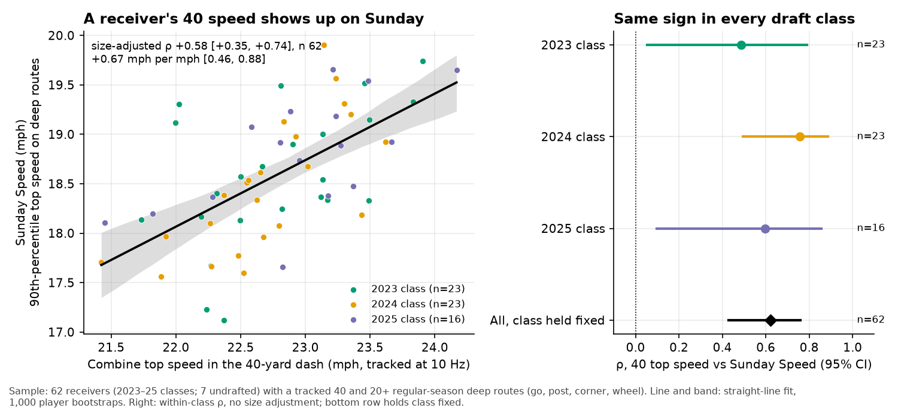
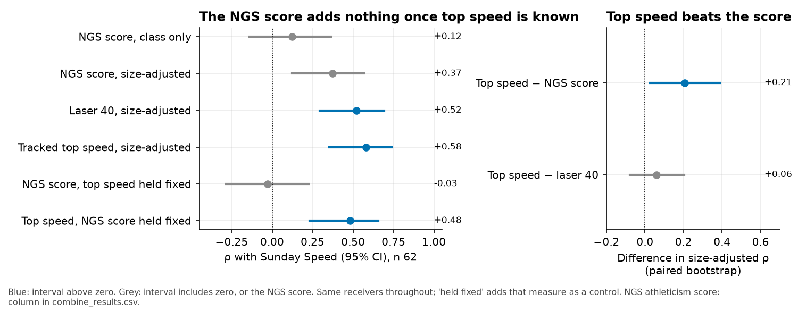
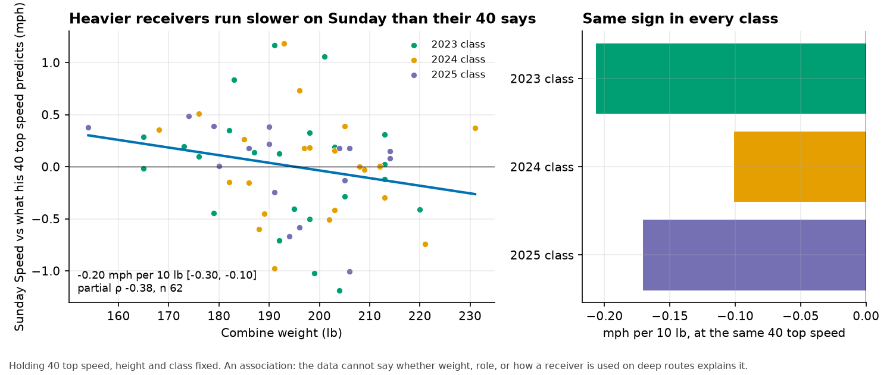
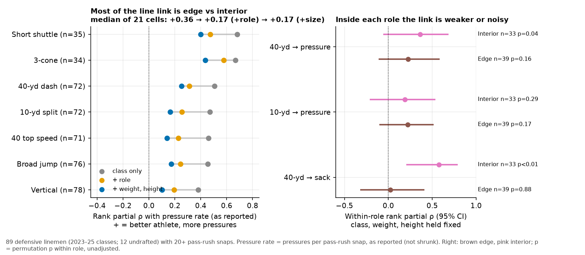
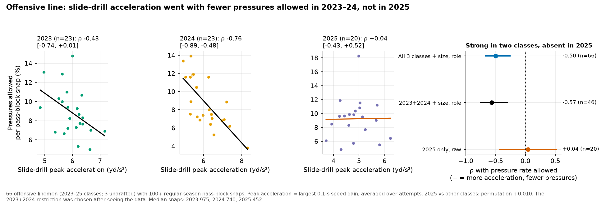
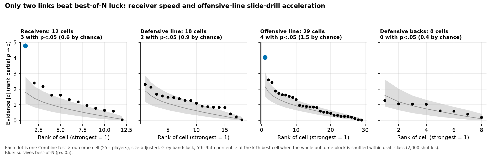

*NFL Big Data Bowl 2027 · Open Track · Combine tracking linked to regular-season game tracking · WR, DL, OL, DB*

**The Combine works, but read it right.** Four findings, the surprising ones first.
1. **The NFL's athleticism score adds nothing once tracked Combine top speed is known.** For receivers, the NGS athleticism score has a partial correlation of −0.03 with game speed once top speed is held fixed; top speed with the score held fixed is +0.48.
2. **Heavier receivers play slower than their own 40 says.** At the same Combine top speed and height, each extra 10 lb goes with 0.20 mph less top speed on deep routes (95% CI −0.30 to −0.10), with the same sign in all three draft classes.
3. **An offensive-line drill result that held in two classes, not the third.** Peak acceleration in the 5-yard slide drill goes with fewer pressures allowed (ρ −0.50, n 66). It survives the multiple-testing checks, holds in the 2023 and 2024 classes (−0.43, −0.76), and is absent in 2025 (+0.04).
4. **Speed carries to Sunday for receivers, but not to production.** Tracked 40 top speed predicts deep-route top speed (ρ +0.58, CI +0.35 to +0.74, n 62) but not yards per route (−0.02, **NOT DETECTED (low power)**).

Defensive-line and defensive-back drills show no result that survives the checks. Most of the line link is the difference between edge and interior rushers.

## The required link: Combine tracking to game tracking
Each player's 10 Hz Combine tracking is joined to his regular-season game tracking (2023–25 draft classes; one to three seasons each, depending on class). **Combine top speed** is the fastest tracked speed in his 40-yard dash (mph). **Sunday Speed** is the 90th percentile of his top speed per play over regular-season deep routes (go, post, corner, wheel; plays not wiped out by penalty; at least 20 routes). The attached public notebook recomputes every number here from the raw competition files and stops with an error if the data are not attached.

**Terms used throughout.** ρ is a rank correlation; positive means the better athlete does better. *Size-adjusted* means holding draft class, weight and height fixed (plus edge/interior for DL, tackle/interior for OL, corner/safety for DB). Intervals are 95% ranges from resampling players; p-values come from 10,000 shuffles; q is the false-discovery-adjusted p within a position group. **Pressure rate** is pressures per pass-rush snap (DL) or allowed per pass-block snap (OL), as reported. **NOT DETECTED (low power)** means no link above the smallest effect the sample could see 8 times in 10 (the MDE); it is not "no link". Colors: blue is a supported link, grey a null, red a reversal; green, orange and purple are always the 2023, 2024 and 2025 classes.

| Sample or check (receivers) | n | ρ, Combine top speed vs Sunday Speed |
|---|---:|---|
| 106 receivers listed → 93 with a tracked 40 → 69 with 20+ deep routes → **both** | **62** | **+0.58 (+0.35, +0.74)** |
| Class only (no size adjustment) | 62 | +0.62 (+0.43, +0.76) |
| Laser-timed 40 instead of tracked top speed | 62 | +0.52 (+0.29, +0.69) |
| Rookie-season routes only (20+) | 57 | +0.69 (+0.51, +0.80) |
| First 20 deep routes only | 62 | +0.50 (+0.27, +0.69) |
| First 30 deep routes only | 61 | +0.46 (+0.24, +0.65) |

*Table 1. Who is in the sample, and whether the receiver link survives other samples. 62 of 106 is 58%: results describe receivers who ran a tracked 40 and saw enough deep routes. 7 of the 62 were undrafted (11%, against 28% of the 106), a description of who is in the sample, not a variable.*

## 1. Receivers: speed carries over, the NGS score doesn't help
Each extra mph of Combine top speed goes with 0.67 mph more Sunday Speed (CI 0.46 to 0.88; a line that resists outliers gives 0.73). The link is positive in every draft class (+0.49 n 23; +0.76 n 23; +0.60 n 16; Figure 1) and holds using rookie-season routes only or only a player's first 20 or 30 deep routes (Table 1).

**The NGS score.** The NFL's athleticism score (a column in the Combine file) correlates only +0.12 with Sunday Speed within draft class (CI −0.14 to +0.36), partly because it rises with weight (ρ +0.39); size-adjusted it is +0.37. Tracked top speed beats it by +0.21 (CI +0.03 to +0.39), and once top speed is known the score adds nothing (−0.03; **NOT DETECTED (low power)**, MDE 0.37; Figure 2). Tracked top speed beats the laser 40 only marginally (+0.06, CI −0.08 to +0.20).

**Weight.** Weight barely relates to a receiver's 40 top speed once height is held fixed (ρ −0.19, CI includes zero), yet heavier receivers are slower on Sunday than that speed predicts (partial ρ −0.38, CI −0.57 to −0.14; −0.20 mph per 10 lb, Figure 3). This is an association: the data cannot say whether weight, role, or how he is used on deep routes explains it.

**Production.** Sunday Speed does not relate to yards per route (−0.02, CI −0.27 to +0.21), deep yards per deep route (+0.01) or targets per deep route (+0.05): **NOT DETECTED (low power)**, MDE 0.34. Speed tells you who is fast on deep routes, not who produces.

## 2. Linemen
**Defensive line.** An earlier version compared adjusted links with a raw baseline built from smoothed rates, which inflated the raw link through edge-versus-interior structure. Here the ladder uses as-reported rates (Figure 4). Across 21 drill-by-outcome cells (pressure, sack and tackle-for-loss rates; n 34 to 78), the median class-adjusted ρ is +0.36; adding edge/interior leaves +0.17 and adding weight and height leaves +0.17. About half the link (53%) is shared with role and size, and nearly all of that is role alone; the share is imprecise (resampling range 13% to 99%).

The 40 against pressure rate is +0.25 size-adjusted (CI +0.00 to +0.48, n 72), a lead that does not survive the checks. Within roles it is +0.22 for edge (n 39) and +0.36 for interior (n 33), both intervals crossing zero (**NOT DETECTED (low power)**; MDE 0.46 and 0.50). Weight is only weakly tied to pressure (−0.15, CI −0.34 to +0.05).

**Offensive line.** Slide-drill peak acceleration (largest 0.1-second speed gain, averaged over attempts) goes with fewer pressures allowed, size-adjusted ρ −0.50 (CI −0.67 to −0.26, n 66). It is the only one of 29 OL tests that survives both the false-discovery check (q 0.003) and the best-of-N check (p 0.004). But it comes from two classes (Figure 5): −0.43 (n 23) and −0.76 (n 23), then +0.04 in 2025 (n 20, CI −0.43 to +0.52). The 2025 class differs from the others (shuffle p 0.010) and has fewer snaps (median 452 against 975 for 2023), which makes its rates noisier; we cannot tell whether that explains it. Without 2025 the link is −0.57 (n 46), a cut chosen after seeing the data. Treat it as a hypothesis to re-test on the 2026 class.

## 3. How many tests, and what survives
After merging duplicates (tracked and laser 40; one pooled DL group), the families hold 12 receiver, 18 DL, 29 OL and 8 DB cells, 67 in all. Chance alone would give about 3 with p < 0.05; 9 do (Figure 6). Only 2 survive the best-of-N check, which shuffles the whole outcome block within draft class (2,000 shuffles) and asks whether the best cell beats the best luck: receiver speed to Sunday Speed (p <0.001) and the OL slide drill. Burst Score is dropped: its recipe was tuned after seeing outcomes.

Table 2 reports held-out effect sizes. For each outcome, the best Combine test is chosen inside two draft classes and scored on the third; 300 shuffles give the luck range.

| Outcome (n) | Held-out R² gain | Luck 95th percentile | p |
|---|---:|---:|---:|
| Receiver Sunday Speed (62) | **+0.190** | +0.070 | 0.003 |
| Receiver separation, break routes (71) | +0.066 | +0.044 | 0.030 |
| Receiver separation, all routes (71) | +0.045 | +0.033 | 0.050 |
| Defensive-line pressure rate (78) | −0.171 | +0.030 | 0.947 |
| Offensive-line pressures allowed (56) | −0.083 | +0.102 | 0.322 |

*Table 2. Held-out gain in R² from adding the best Combine test to a size-only model. With 5 outcomes, only bold rows clear 0.05/5.*

## 4. Defensive backs and tight ends
None of the 8 DB cells (tackle and tackle-for-loss rates; n about 62) reaches p < 0.05 (best q 0.53): **NOT DETECTED (low power)**. With about 62 backs, only links of ρ 0.37 or more are seen 8 times in 10. Tight ends: 25 of 42 have a tracked 40 and 20+ routes, so only links of about 0.58 could be seen; not analysed further.

## What a team would do differently
- **Estimate deep speed from tracked top speed, not the NGS score.** Expect about two-thirds of a mph of Sunday Speed per mph at the Combine, and shade a heavy receiver below his 40.
- **Don't expect speed to buy production.** Pay for deep speed as a skill, not as a forecast of yards.
- **Read line drills within role and weight,** and re-test the OL slide drill on 2026 rookies.

## Methods and limitations
- **Correlation, not cause.** No blocker or quarterback tracks are linked, so pressure results also reflect teammates and schemes.
- **Selection.** Players need a tracked drill and enough snaps; skipped drills and unplayed seasons are not random. 2023 players have three seasons, 2025 players one.
- **Multiplicity.** We explored more than the 67 cells shown (Burst Score recipes, clustering, other drills), so even adjusted p-values are optimistic. The receiver speed link is the result least exposed to this.
- **Small samples.** Intervals are wide; **NOT DETECTED (low power)** means below the MDE, not no link.
- **Reproducibility.** Seed 2027; rank correlations hold class, weight and height fixed; p from residual shuffles; intervals from 2,000 player resamples.

Data: NFL Big Data Bowl 2027 competition files (CC BY-NC 4.0). Draft slot, pick and round are not used.
